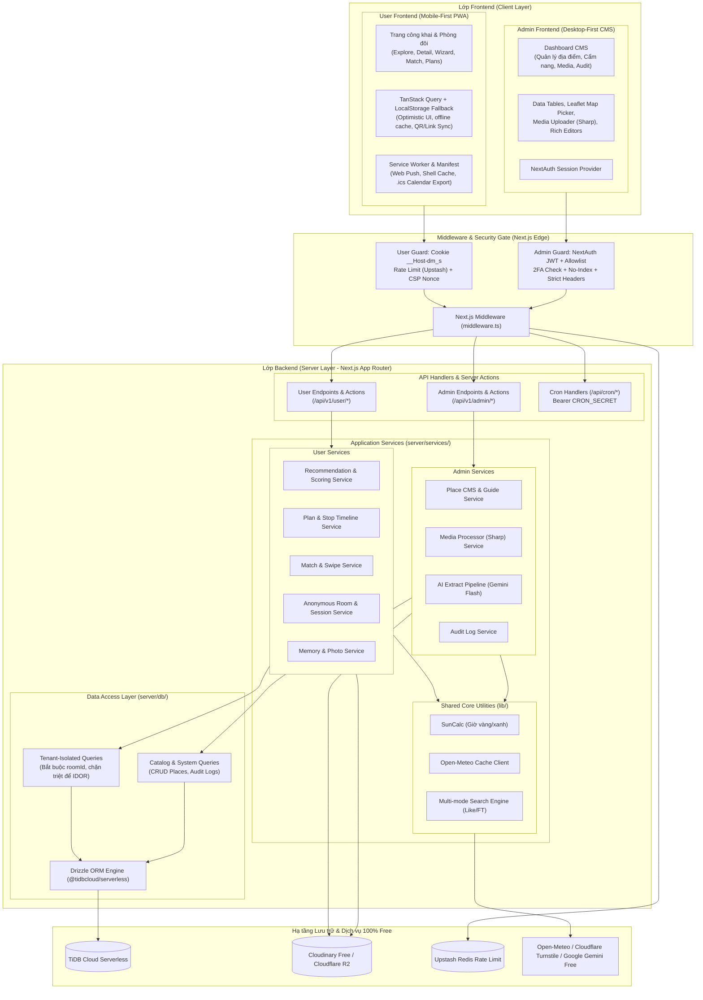

# Plan & Spec: Web app lên lịch đi chơi cho cặp đôi

*Tên tạm: **DateMate**. Phiên bản tài liệu 1.0, ngày 27/10/2026.*

## 0. Cập nhật v1.2 (27/10/2026): Tối ưu Kiến trúc & Giải pháp 100% Miễn phí

Bản cập nhật v1.2 chuẩn hóa toàn diện:
1. **Kiến trúc phân tách triệt để FE/BE (User vs Admin)**: Tách riêng luồng User (Mobile-first PWA, siêu nhẹ, bundle JS < 170KB) và Admin (Desktop-first CMS, giàu tính năng) để đảm bảo tốc độ và an toàn dữ liệu, chống IDOR từ tầng Data Access Layer (DAL).
2. **Cam kết 100% Free - 0 đồng chi phí vận hành**: Thay thế mọi dịch vụ ngoài bằng các giải pháp miễn phí không cần thẻ tín dụng:
   - **AI trích xuất cẩm nang**: Dùng **Google Gemini 1.5/2.5 Flash** (Google AI Studio API - Free Tier 15 RPM, 1.500 RPD) thay cho Claude API tính phí.
   - **Cơ chế chống mất phòng**: Bổ sung **Mã QR phòng**, **Link sao lưu 1-chạm** (`/r/sync?k=...`) gửi qua Zalo/Ghi chú và cơ chế phục hồi ngầm (Silent Recovery từ LocalStorage/IndexedDB) nếu cookie bị Safari ITP dọn dẹp.
   - **Nhắc lịch chống xịt**: Thêm nút **Xuất lịch `.ics` (Sync Apple Calendar / Google Calendar)** nhắc chuông trước 2 giờ trực tiếp từ hệ điều hành điện thoại, không lo bị chặn Web Push trên iOS.
   - **TiDB Serverless Concurrency**: Dùng lệnh cập nhật nguyên tử (Atomic Conditional Update `member_count`) thay cho transaction khóa dòng, tương thích 100% với driver HTTP serverless không gây treo kết nối.

### 0.1 Bảng quyết định cập nhật v1.2

| Hạng mục | Quyết định v1.2 | Lợi ích & Nơi áp dụng |
| --- | --- | --- |
| Kiến trúc FE | Tách biệt `(user)` và `admin` | Bundle User siêu nhẹ, LCP < 2.5s; Admin đầy đủ công cụ CMS (Mục 3) |
| Kiến trúc BE | Tách `/api/v1/user/*` và `/api/v1/admin/*` | Middleware Edge Guard phân luồng, DAL chặn triệt để IDOR (Mục 3, 6) |
| Dữ liệu & Phiên | Cookie `__Host-dm_s` + Silent LocalStorage fallback + QR/Link Sync | Không sợ mất phòng khi Safari xóa cookie, khôi phục 1 chạm (F01, F02) |
| Ghép đôi | Atomic Update `member_count < 2` | Chống quá 2 thiết bị mà không cần khóa dòng phức tạp trên TiDB HTTP driver |
| AI Admin | Google Gemini Flash (Google AI Studio) | 100% Free, trích xuất cẩm nang có cấu trúc chuẩn tiếng Việt (F17) |
| Nhắc lịch | Web Push (VAPID) + Tải file `.ics` Calendar | 100% tin cậy cả trên iPhone lẫn Android, không tốn chi phí SMS/Push trả phí (F08, F18) |
| Lưu trữ Media | Cloudinary Free (catalog) + Cloudflare R2 / Vercel Blob (kỷ niệm) + Client compression | Tự nén WebP ngay trên máy người dùng trước khi gửi, tiết kiệm 90% dung lượng và băng thông |
| Bảo mật | ASVS Cấp 1, Zod Strict, CSP Nonce, Turnstile | An toàn cao nhất cho mô hình không tài khoản (Mục 13) |

### 0.2 Mô hình không tài khoản: phiên ẩn danh, chống mất dữ liệu và phòng đôi

1. **Vào là dùng.** Khám phá, wizard, quay số, xem cẩm nang đều không cần gì. Địa điểm "đã lưu" của người chưa có phòng nằm trong bộ nhớ trình duyệt (localStorage), không lên server.
2. **Phòng được tạo ngầm** khi người dùng làm việc cần lưu lâu dài lần đầu (tạo kế hoạch, bắt đầu Match, viết kỷ niệm). Server sinh `room` và trả cookie phiên; người dùng chỉ thấy "Đã lưu cho bạn".
3. **Mời người ấy:** bấm "Mời người ấy" để nhận một **link bí mật** (`/r/<token>`, 128 bit ngẫu nhiên) và một **mã 8 ký tự** dùng một lần, hết hạn sau 24 giờ. Người kia mở link hoặc nhập mã, đặt biệt danh, rồi vào cùng phòng.
4. **Cơ chế ghép phòng nguyên tử (Atomic Join):** Sử dụng câu lệnh nguyên tử `UPDATE rooms SET member_count = member_count + 1 WHERE id = ? AND member_count < 2;`. Nếu số dòng cập nhật = 1 mới tiến hành tạo bản ghi `room_members`. Cơ chế này hoạt động hoàn hảo trên serverless HTTP driver mà không cần connection lock.
5. **Cookie phiên & Silent Recovery:** `__Host-dm_s`, HttpOnly, Secure, SameSite=Lax, giá trị là token ngẫu nhiên 256 bit. DB chỉ lưu băm SHA-256. Đồng thời app lưu khóa phục hồi ẩn vào `localStorage` của trình duyệt. Nếu Safari ITP vô tình xóa cookie phiên, app sẽ tự động gửi request Silent Re-auth để khôi phục cookie mà người dùng không hay biết.
6. **Sao lưu 1-chạm & Mã QR:** Khi có kế hoạch đầu tiên, ngoài chuỗi khóa khôi phục, app hỗ trợ:
   - **Tạo mã QR phòng**: Người yêu quét là vào phòng ngay.
   - **Nút "Gửi link sao lưu qua Zalo/Tin nhắn"**: Link dạng `/r/sync?key=...` để người dùng tự gửi cho chính mình hoặc lưu vào Ghi chú (Notes). Mất máy chỉ cần click link là khôi phục lại toàn bộ dữ liệu.
7. **Không thu email, số điện thoại hay tên thật.** Chỉ có biệt danh tuỳ chọn.
8. **Xóa phòng** (xóa cứng toàn bộ kế hoạch, ảnh, Match) bằng một nút có xác nhận. Phòng không hoạt động 12 tháng bị đánh dấu và xóa sau cảnh báo.

### 0.3 Bảng màu hồng đào

| Vai trò | Màu | Dùng cho |
| --- | --- | --- |
| Nền | `#FFF7F3` (kem) | Nền trang |
| Hồng đào nhạt | `#FFE3DA` | Thẻ, chip, vùng nhấn nhẹ |
| Hồng đào | `#FF9E8D` | Biểu tượng, đường nhấn, trạng thái chọn |
| Hồng đào đậm | `#C93F52` | Nút chính, liên kết (chữ trắng trên màu này đạt tỷ lệ tương phản khoảng 4.9:1) |
| Chữ | `#3B2A2A` (nâu ấm) | Nội dung |
| Phụ | `#7A9E87` (xanh lá dịu) | Nhãn "nên đi", trạng thái thành công |

Phong cách: bo góc lớn (16-24px), ảnh bìa tràn, chữ tròn thân thiện (ví dụ Be Vietnam Pro hoặc Nunito, nhớ có font dự phòng).

### 0.4 Bảng đối chiếu thay đổi dữ liệu

| Cũ | Mới |
| --- | --- |
| `users` | `room_members` (thiết bị trong phòng, không có email) |
| `couples` | `rooms` |
| `couple_id` | `room_id` (lấy từ cookie phiên ở server, không tin client) |
| `user_id`, `created_by`, `assigned_to` | `member_id` |
| `saved_places` theo user | localStorage khi chưa có phòng; bảng `saved_places(member_id, place_id)` khi đã có phòng |
| `district` của địa điểm | `area` (tên khu vực thông dụng như Hoàn Kiếm, Tây Hồ), vì địa giới hành chính Hà Nội đã thay đổi nhiều nên không gắn cứng theo quận cũ |

### 0.5 Cập nhật v1.3 (27/10/2026): Ảnh minh họa giai đoạn nội bộ

App đang dùng **nội bộ**, chưa public. Trong giai đoạn này cho phép dùng ảnh chưa rõ bản quyền để có nội dung thử nghiệm, kèm các ràng buộc:

| Hạng mục | Quyết định v1.3 |
| --- | --- |
| Nguồn ảnh nội bộ | Admin **tự tìm** ảnh (ví dụ Google Images trên trình duyệt) và dán link vào `scripts/data/image-links.json`; `pnpm media:fetch --download` tải về `scripts/output/images/` (không commit) |
| Không cào tự động Google | Google đã đóng Custom Search JSON API với khách mới (thông báo 20/01/2026, tắt hẳn 01/01/2027) và trang tìm kiếm có lớp chống bot; không lách lớp này |
| Đánh dấu | Ảnh tự chọn mang `license: "unverified"`, `internalOnly: true`; **không** import vào `place_media` của bản public |
| Nguồn hợp lệ dùng song song | Wikimedia Commons (không cần key, chỉ giữ CC0/PD/CC BY/CC BY-SA), TikTok/YouTube qua oEmbed (`embed_only`) |
| Điều kiện trước khi public | Thay toàn bộ ảnh `unverified` bằng ảnh Unsplash/Pexels (khi có key) hoặc ảnh tự chụp; mục 2.6 và 8.3 áp dụng lại đầy đủ |

## 1. Tổng quan

### 1.1 Vấn đề

Cặp đôi bí ý tưởng đi chơi vì ba lý do: không biết đi đâu, không biết đi lúc nào cho đẹp, và lười lên kế hoạch.

### 1.2 Giải pháp

Một web app mobile-first (cài được như app qua PWA). Mỗi địa điểm đi kèm **cẩm nang**: giờ đẹp, ngày nên đi, góc chụp, pose, trang phục, video tham khảo. Nút chính trên trang chủ là **"Hôm nay đi đâu?"** để người dùng không phải tự lục tìm.

### 1.3 Nguyên tắc sản phẩm

- Mỗi màn hình chỉ có **một hành động chính**, nút to, thao tác một tay.
- Ưu tiên **chạm chọn**, hạn chế gõ chữ.
- Ngôn ngữ thân thiện ("Hợp đi lúc 17:30 nha" thay cho "Golden hour 17:30").
- Video và ảnh nguồn ngoài chỉ **nhúng link**, không tải về tự host.
- Bắt đầu hẹp: **một thành phố (Hà Nội)**, 30-40 địa điểm chất lượng.

### 1.4 Người dùng và phạm vi

| Vai trò | Mô tả | Quyền |
| --- | --- | --- |
| Khách | Chưa đăng nhập | Xem khám phá, chi tiết địa điểm, dùng wizard (không lưu) |
| Thành viên | Đã đăng nhập, chưa ghép cặp | Lưu địa điểm, tạo kế hoạch cá nhân |
| Cặp đôi | Hai thành viên đã liên kết | Kế hoạch chung, Match, kỷ niệm, nhắc lịch |
| Admin | Người quản trị nội dung | CRUD địa điểm, cẩm nang, media, duyệt đóng góp |

**Ngoài phạm vi MVP:** thanh toán, đặt chỗ thật, chat, mạng xã hội công khai, app native.

### 1.5 Chỉ số thành công (sau 3 tháng)

- 70% người dùng mới hoàn thành wizard và xem ít nhất 1 gợi ý.
- 40% cặp đôi tạo ít nhất 1 kế hoạch trong tuần đầu.
- Thời gian từ mở app đến chọn được địa điểm dưới 60 giây.

## 2. Công nghệ đề xuất

### 2.1 Quyết định chính

**Một ngôn ngữ cho tất cả: TypeScript.** Một codebase, một lần deploy, dùng chung kiểu dữ liệu giữa FE và BE, phù hợp người làm một mình hoặc nhóm nhỏ, và khớp tự nhiên với Vercel.

| Lớp | Lựa chọn | Lý do |
| --- | --- | --- |
| Ngôn ngữ | **TypeScript** (strict) | Một ngôn ngữ cho FE + BE, bắt lỗi sớm, hệ sinh thái lớn |
| Framework | **Next.js 15 (App Router)** + React 19 | FE + API trong một project, SSR/ISR cho trang địa điểm (SEO tốt), deploy Vercel một cú |
| UI | **Tailwind CSS + shadcn/ui** | Làm nhanh, giao diện đẹp, tùy biến dễ, tách biệt component User và Admin |
| Animation | Framer Motion (`LazyMotion`) | Vuốt thẻ Match, chuyển cảnh mượt, nạp lười giảm bundle |
| Data fetching | Server Components + **TanStack Query** | Tải dữ liệu phía server, cache phía client, polling Match 5s, Optimistic UI |
| Form + validate | **React Hook Form + Zod** | Một schema Zod dùng chung cho cả form và API (Zod strict chống mass assignment) |
| Kéo thả | dnd-kit | Sắp xếp các điểm trong lộ trình, hỗ trợ cảm ứng mượt trên mobile |
| Bản đồ | **Leaflet + OpenStreetMap** | Miễn phí 100%, không cần thẻ thanh toán; nút "Chỉ đường" mở thẳng app Google Maps/Apple Maps bằng URL schema |
| ORM | **Drizzle ORM** | Nhẹ, hợp serverless, hỗ trợ MySQL/TiDB, kiểu dữ liệu chặt |
| Database | **TiDB Cloud (Serverless)** | Gói Free 5GB, 50M RU/tháng. Dùng driver HTTP `@tidbcloud/serverless` + Atomic Update tránh cạn pool |
| Auth | **Phiên ẩn danh (User) & OAuth (Admin)** | User dùng cookie `__Host-dm_s` băm SHA-256 + LocalStorage Silent Recovery; Admin dùng NextAuth OAuth + allowlist + 2FA |
| Lưu ảnh | **Cloudinary (catalog) + Cloudflare R2 / Vercel Blob (kỷ niệm)** | Nén WebP ngay tại client bằng `browser-image-compression` trước khi upload, tiết kiệm 90% băng thông |
| Giờ vàng | **SunCalc** | Tính giờ mặt trời mọc/lặn theo tọa độ + ngày, chạy offline 100% bằng toán JS |
| Thời tiết | **Open-Meteo** | Miễn phí 100%, không cần API key, cache server 30 phút theo tọa độ làm tròn |
| Nhắc lịch | **Web Push (VAPID) + File `.ics` Calendar** | File `.ics` 1-chạm đồng bộ vào Apple Calendar / Google Calendar (nhắc chuông OS tự động, 0 đồng, không lo trượt push iOS) |
| Lập lịch Cron | **cron-job.org / GitHub Actions** | Gọi `/api/cron/reminders` 15 phút/lần hoàn toàn miễn phí, vượt giới hạn 1 lần/ngày của Vercel Hobby |
| AI nhập liệu | **Google Gemini Flash (Google AI Studio)** | Miễn phí 100% (15 RPM, 1.500 RPD không cần thẻ tín dụng), trích xuất cẩm nang cực chuẩn tiếng Việt |
| Test | Vitest + Playwright | Unit cho logic gợi ý/search, E2E cho luồng ghép phòng & kế hoạch |
| CI/CD | GitHub + Vercel Git integration | Mỗi PR có preview URL, quét lỗ hổng và kiểm tra bảo mật tự động |

### 2.2 Vì sao không tách BE riêng?

Với quy mô vài trăm đến vài nghìn người dùng, Next.js Route Handlers và Server Actions đủ làm BE. Tách thêm NestJS/FastAPI chỉ làm tăng chi phí vận hành và deploy. Khi cần (job nền nặng, realtime lớn), có thể tách service sau mà không phải viết lại, nhờ lớp `server/` đã tách riêng ở mục 3.

### 2.3 Vì sao TiDB Cloud Serverless & Chiến lược Concurrency 100% Free?

- Tương thích MySQL, ORM Drizzle chạy chuẩn chỉ.
- Có kiểu **JSON** (rất hợp cho tags, pose, trang phục).
- Gói Serverless có 5GB dung lượng và 50M Request Units miễn phí hàng tháng trọn đời.
- **Xử lý kết nối:** Kết nối từ Vercel serverless dùng driver HTTP `@tidbcloud/serverless` (không dùng TCP socket truyền thống), loại bỏ hoàn toàn vấn đề cạn connection pool và cold start.
- **Concurrency không cần khóa dòng:** Để giới hạn phòng tối đa 2 thiết bị mà không cần connection stateful lock (`SELECT ... FOR UPDATE`), hệ thống sử dụng câu lệnh nguyên tử:
  `UPDATE rooms SET member_count = member_count + 1 WHERE id = ? AND member_count < 2;`
  Chỉ khi câu lệnh trả về `affectedRows = 1` thì serverless function mới tạo thiết bị mới. Cách này chạy cực nhanh, an toàn 100% trên HTTP driver.

### 2.4 Phương án thay thế

| Nếu bạn... | Thì cân nhắc |
| --- | --- |
| Muốn realtime Match mượt không cần polling | Dùng polling 5 giây ở MVP (0 đồng, nhẹ nhàng); nâng cấp lên Pusher/Ably gói free khi cần |
| Cần full-text search tiếng Việt tốt | Chế độ `like` chuẩn hóa bỏ dấu trong `server/services/shared/search.service.ts`, phản hồi <20ms cho vài trăm địa điểm, 0 đồng |
| Sau này làm app native | Giữ logic ở `server/services/`, mở thêm REST endpoint chuẩn `/api/v1/user/*`, mobile app gọi chung |

### 2.5 Dịch vụ bên ngoài: Cam kết 100% miễn phí (0 đồng, không cần thẻ)

Mọi API bên ngoài đều chọn loại miễn phí 100%, không cần add thẻ tín dụng quốc tế. Nguyên tắc: nếu một dịch vụ ngoài lỗi hoặc nghẽn mạng, app vẫn chạy trơn tru (ẩn khối thời tiết, mở Google Maps ngoài, nhắc hẹn qua file lịch .ics).

| Dịch vụ | Dùng cho | Chi phí & Hạn mức miễn phí | Lưu ý và phương án dự phòng |
| --- | --- | --- | --- |
| **Open-Meteo** | Thời tiết (F12) | 10,000 lượt gọi/ngày miễn phí, không cần API key | Gọi từ server và cache 30 phút theo tọa độ làm tròn `lat.toFixed(2)` |
| **SunCalc** | Giờ vàng, giờ xanh (F13) | 0 đồng (thư viện toán học chạy offline) | Chạy ngay trong runtime, không tốn bất kỳ tài nguyên mạng nào |
| **OpenStreetMap + Leaflet** | Bản đồ nhỏ trên trang địa điểm | Miễn phí | Không dùng Google Maps API đắt đỏ. Nút "Chỉ đường" mở trực tiếp ứng dụng Google Maps / Apple Maps bằng deep link URL miễn phí 100% |
| **Nominatim (OSM)** | Admin tra tọa độ, địa chỉ | Miễn phí (giới hạn 1 req/giây) | Chỉ admin dùng trong CMS khi tạo địa điểm mới |
| **Cloudinary** | Media cẩm nang & catalog công khai | 25 Credit/tháng miễn phí (~25GB lưu trữ/băng thông) | Tự động resize WebP/AVIF bằng URL (`f_auto,q_auto,w_800`), tích hợp CDN toàn cầu |
| **Cloudflare R2 / Vercel Blob** | Ảnh kỷ niệm riêng tư cặp đôi | R2 miễn phí 10GB, **0 đồng băng thông ra** | Ảnh được nén ở client xuống <300KB trước khi upload, tiết kiệm tối đa dung lượng |
| **Upstash Redis** | Rate limit trượt (Mục 13.5) | 10,000 commands/ngày miễn phí | Đủ cho hàng nghìn lượt truy cập/ngày; vượt ngưỡng tự fallback sang in-memory rate limit |
| **Cloudflare Turnstile** | Chống bot tạo phòng / brute force | Miễn phí 100% không giới hạn | Trải nghiệm mượt mà, không bắt người dùng chọn hình captcha khó chịu |
| **Lịch điện thoại (.ics)** | Nhắc lịch hẹn chuẩn xác 100% | Miễn phí 100% | Tạo file iCalendar (.ics) tải về máy; 1-click là thêm vào Apple Calendar / Google Calendar, máy tự phát chuông báo trước 2 giờ |
| **Web Push (VAPID)** | Thông báo đẩy trên trình duyệt/PWA | Miễn phí 100% | Hoạt động trên Android Chrome và iOS Safari PWA (đã Add to Home Screen) |
| **cron-job.org / GitHub Actions** | Kích hoạt cron nhắc lịch 15 phút/lần | Miễn phí 100% | Gọi endpoint `/api/cron/reminders` có Bearer `CRON_SECRET`, không bị giới hạn 1 lần/ngày của Vercel |
| **Google Gemini Flash** (Google AI Studio) | AI trích xuất cẩm nang cho Admin (F17) | Miễn phí 100% (15 RPM, 1.500 RPD không cần thẻ) | Dán caption/link review, Gemini tự động parse ra JSON cẩm nang (giờ đẹp, pose, tips) để Admin duyệt |
| **Sentry & Vercel Analytics** | Theo dõi lỗi & Web Vitals | Gói miễn phí 5,000 lỗi/tháng | Giúp phát hiện sớm lỗi LCP/INP trên mobile 4G |

Ghi chú về nền tảng: gói Hobby của Vercel thường dành cho dự án phi thương mại. Nếu sau này app có quảng cáo hoặc thu phí, hãy kiểm tra điều khoản và cân nhắc nâng gói. Tổng chi phí dự kiến khi dưới các ngưỡng miễn phí là 0 đồng, ngoại trừ tên miền riêng (nếu mua).

### 2.6 Lưu ảnh và video trực tiếp trên storage (đã nén)

**Quyết định:** media minh họa của địa điểm được lưu thẳng trên storage của app, nén trước khi lưu để giảm dung lượng và thời gian tải. Nhúng video từ nền tảng khác chỉ còn là phương án dự phòng.

**Giới hạn cần nói rõ:** tự lưu và phát lại video TikTok/Instagram của người khác là vi phạm điều khoản nền tảng và bản quyền, dù là để minh họa. Vì vậy chỉ lưu file thuộc một trong bốn nhóm: tự chụp/quay, giấy phép cho phép đăng lại (CC0, hoặc điều khoản của Unsplash/Pexels, nhớ đọc kỹ phần video), có sự đồng ý bằng văn bản của tác giả, hoặc ảnh do người dùng đóng góp có đồng ý điều khoản. CMS bắt buộc chọn `license` trước khi xuất bản. *(Ngoại lệ tạm thời cho giai đoạn nội bộ: xem mục 0.5.)*

#### Quy trình nén

| Loại | Chuẩn đầu ra | Mục tiêu dung lượng | Cách làm |
| --- | --- | --- | --- |
| Ảnh | WebP, 3 kích thước: 480 / 960 / 1600 px cạnh dài, chất lượng khoảng 75-80, xóa EXIF, kèm ảnh mờ (blurhash) | Bìa 960 px dưới \~150 KB; ảnh chi tiết 1600 px dưới \~300 KB | `sharp` ở route upload hoặc script `scripts/optimize-media.ts`; hiển thị bằng `srcset` |
| Video | MP4 H.264, tối đa 720p, tối đa 30 giây, bitrate khoảng 1.2-1.8 Mbps, `+faststart`, thường bỏ âm thanh | Dưới \~6 MB mỗi clip | Nén bằng ffmpeg **trên máy admin** hoặc trong CI, không chạy trong hàm serverless (giới hạn thời gian và bộ nhớ) |
| Poster video | WebP/JPEG 960 px | Dưới \~80 KB | Trích khung hình từ clip bằng ffmpeg |

Lệnh mẫu: `ffmpeg -i in.mov -vf "scale=-2:720" -c:v libx264 -crf 28 -preset slow -an -movflags +faststart out.mp4`. Có thể tạo thêm bản WebM/AV1 để nhẹ hơn, khi đó dùng nhiều thẻ `<source>` và để MP4 làm bản dự phòng.

#### Tải lên và phát

- **Tải trực tiếp từ trình duyệt lên storage** bằng token ngắn hạn do server cấp, để tệp không đi qua hàm serverless (thân request của hàm có giới hạn kích thước). Sau khi xong, server kiểm tra lại kích thước, định dạng và ghi metadata vào `place_media`.
- **Phát video:** `<video muted playsinline preload="none" poster="...">`, chỉ tải khi bấm; chỉ một video phát cùng lúc; tôn trọng chế độ tiết kiệm dữ liệu (chỉ hiện poster); ảnh dùng `loading="lazy"` trừ ảnh bìa.
- **CSP:** thêm domain storage vào `img-src` và `media-src` (mục 13.4).

#### Chọn nơi lưu

| Phương án | Điểm mạnh | Điểm yếu và lưu ý |
| --- | --- | --- |
| **Cloudinary (gói miễn phí)** | Có CDN, tự đổi định dạng và nén theo thiết bị (`f_auto`, `q_auto`) cho cả ảnh và video, tạo kích thước tại chỗ | Hạn mức tính theo "credit", cần theo dõi khi lượt xem tăng |
| Cloudflare R2 | Dung lượng miễn phí khá lớn, không tính phí băng thông ra | Tự lo phần nén/resize; có thể yêu cầu thêm phương thức thanh toán khi đăng ký, cần xác minh |
| Vercel Blob | Tích hợp sẵn với Vercel, đơn giản | Gói miễn phí nhỏ; phù hợp ảnh kỷ niệm hơn media công khai |
| Supabase Storage | Dễ dùng, có biến đổi ảnh | Dung lượng miễn phí nhỏ |

**Đề xuất:** media công khai của địa điểm đặt trên **Cloudinary** (tận dụng nén và CDN tự động), còn **ảnh kỷ niệm riêng tư** của cặp đôi đặt trên Vercel Blob hoặc kho riêng tư và phát qua route có kiểm tra quyền (mục 13.6). Hạn mức miễn phí thay đổi theo thời gian, hãy kiểm tra lại trước khi chọn.

#### Ước tính dung lượng

Với 36 địa điểm, mỗi nơi khoảng 6 ảnh (\~250 KB) và 1 video (\~5 MB), tổng khoảng **230 MB**, thấp hơn nhiều so với hạn mức miễn phí thông thường. Băng thông mới là thứ cần theo dõi: giữ video ở chế độ bấm mới tải, đặt `Cache-Control` dài cho tệp có tên chứa mã băm nội dung, và dùng CDN.

## 3. Kiến trúc hệ thống phân tầng (User vs Admin)

Hệ thống được thiết kế theo mô hình **Monolithic Modular trên Next.js 15 (App Router)**: dùng chung một codebase và một database để tối ưu chi phí deploy (0 đồng trên Vercel), nhưng **phân tách triệt để ranh giới mã nguồn giữa User và Admin** từ giao diện, routing, middleware cho tới service và truy vấn dữ liệu.

### 3.1 Sơ đồ kiến trúc tổng thể



### 3.2 Nguyên tắc phân tách kiến trúc FE & BE

#### A. Phân tách Frontend (User vs Admin)

| Tiêu chí | User Frontend (`app/(user)/`) | Admin Frontend (`app/admin/`) |
| :--- | :--- | :--- |
| **Mục tiêu chính** | Siêu nhẹ, tải tức thì (<2.5s LCP trên 4G), mượt mà trên mobile, thao tác một tay. | Trực quan, đa năng, hỗ trợ nhập liệu nhanh trên màn hình Desktop/Laptop lớn. |
| **Bố cục & Shell** | Mobile-First: Bottom Navigation 5 tab cố định, Bottom Sheet Drawer, thẻ vuốt Match. | Desktop-First: Collapsible Sidebar, Header chứa profile/logout, Breadcrumb navigation. |
| **Quản lý State** | - Server Components cho SEO và ISR trang chi tiết.<br/>- **TanStack Query** cho client state, polling Match (5s), optimistic UI (thả tim, đổi thứ tự stop). | - Server Actions cho form cập nhật CMS.<br/>- TanStack Table cho phân trang, lọc và sắp xếp danh sách địa điểm. |
| **Thư viện UI** | - shadcn/ui nguyên tử tối giản (Button, Dialog, Drawer, Carousel).<br/>- Framer Motion với `LazyMotion` để giảm bundle.<br/>- `dnd-kit` cảm ứng cho timeline kế hoạch.<br/>- **Cấm nhập các thư viện nặng của Admin**. | - shadcn/ui đầy đủ (Data Table, Form, Tabs, Dropdown).<br/>- Leaflet Map component để click ghim tọa độ.<br/>- Markdown Editor cho nội dung cẩm nang. |
| **Ngân sách Bundle** | Bundle JS ban đầu **dưới 170 KB** (gzip). PWA Service Worker cache offline. | Chấp nhận bundle 400-600 KB do chạy trên môi trường máy tính văn phòng/wifi. |

#### B. Phân tách Backend (User vs Admin)

| Tiêu chí | User Backend (`/api/v1/user/*`) | Admin Backend (`/api/v1/admin/*`) |
| :--- | :--- | :--- |
| **Cơ chế Xác thực** | **Phiên ẩn danh:** Token 256-bit trong cookie `__Host-dm_s`. Server băm SHA-256 so khớp DB.<br/>- Guard: `requireRoomSession(req)` trả về `{ roomId, memberId }`.<br/>- Hỗ trợ Silent Auto-Recovery từ LocalStorage nếu Safari ITP xóa cookie. | **NextAuth OAuth (Google/GitHub):**<br/>- Email Allowlist nghiêm ngặt trong biến môi trường.<br/>- Yêu cầu bắt buộc bật 2FA trên tài khoản quản trị.<br/>- Guard: `requireAdmin(req)`. |
| **Kiểm soát Quyền & IDOR** | - **Mọi hàm trong User DAL bắt buộc nhận `roomId`** từ session, tuyệt đối không nhận từ request body/params.<br/>- Kế hoạch bí mật: tự động che giấu `stops` trước thời điểm `reveal_at`. | - Quyền truy cập catalog toàn cục (`places`, `place_guides`, `place_media`).<br/>- Mọi thay đổi dữ liệu bắt buộc ghi log vào `audit_logs` (ai sửa, lúc nào, trường nào). |
| **Bộ nhớ đệm (Cache)** | - Trang chi tiết địa điểm dùng **ISR (Incremental Static Regeneration)** cache 1 giờ.<br/>- API địa điểm công khai có `Cache-Control: public, s-maxage=1800, stale-while-revalidate=86400`. | - **On-Demand Cache Invalidation:** Khi Admin xuất bản hoặc sửa địa điểm, tự động trigger `revalidatePath('/places/[slug]')` và `revalidateTag('places-list')` để User thấy ngay nội dung mới. |
| **Bảo vệ & Rate Limit** | - Giới hạn tần suất trượt (Upstash Redis) theo IP và theo Room.<br/>- Cloudflare Turnstile bảo vệ bước tạo phòng, nhập mã và upload ảnh. | - Giới hạn 20 req/phút cho các route nặng (AI Gemini trích xuất, xử lý nén media Sharp). |

### 3.3 Cấu trúc thư mục chuẩn hóa (Modular Clean Directory)

```
datemate/
├── app/
│   ├── (user)/                          # FRONTEND USER
│   │   ├── (public)/                    # Trang công khai (SEO cao, ISR)
│   │   │   ├── page.tsx                 # Trang chủ (F20)
│   │   │   ├── explore/page.tsx         # Khám phá địa điểm (F03)
│   │   │   └── places/[slug]/page.tsx   # Cẩm nang chi tiết (F04, ISR 1h)
│   │   ├── (app)/                       # Trang chức năng (cần phiên phòng)
│   │   │   ├── layout.tsx               # Shell Mobile + BottomNav
│   │   │   ├── wizard/page.tsx          # Wizard "Hôm nay đi đâu" (F05)
│   │   │   ├── match/page.tsx           # Match quẹt thẻ (F07)
│   │   │   ├── plans/                   # Kế hoạch & Timeline (F08, F09)
│   │   │   │   ├── page.tsx
│   │   │   │   └── [id]/page.tsx
│   │   │   ├── memories/page.tsx        # Kho kỷ niệm (F11)
│   │   │   └── room/page.tsx            # Quản lý phòng, QR & Sao lưu (F01, F02)
│   │   └── r/
│   │       ├── [token]/page.tsx         # Trang xác nhận vào phòng từ link mời
│   │       └── sync/page.tsx            # Trang khôi phục phòng 1-chạm từ link sao lưu
│   │
│   ├── admin/                           # FRONTEND ADMIN (CMS Desktop)
│   │   ├── layout.tsx                   # Admin Shell (Sidebar, Header, Breadcrumb)
│   │   ├── login/page.tsx               # Đăng nhập OAuth Admin
│   │   ├── page.tsx                     # Dashboard tổng quan
│   │   ├── places/                      # Quản lý địa điểm & cẩm nang (F16)
│   │   │   ├── page.tsx                 # Danh sách địa điểm (Data Table)
│   │   │   ├── new/page.tsx             # Thêm địa điểm mới
│   │   │   └── [id]/edit/page.tsx       # Form sửa cẩm nang + map picker
│   │   ├── media/page.tsx               # Quản lý media & bản quyền
│   │   └── audit-logs/page.tsx          # Lịch sử thay đổi hệ thống
│   │
│   ├── api/                             # BACKEND ENDPOINTS
│   │   ├── v1/
│   │   │   ├── user/                    # API User
│   │   │   │   ├── session/route.ts     # Tạo/khôi phục cookie phiên
│   │   │   │   ├── rooms/route.ts       # Mời/vào phòng/rời phòng
│   │   │   │   ├── places/route.ts      # Danh sách & tìm kiếm đa chế độ
│   │   │   │   ├── recommend/route.ts   # Thuật toán wizard chấm điểm
│   │   │   │   ├── plans/route.ts       # CRUD kế hoạch
│   │   │   │   ├── swipes/route.ts      # Quẹt thẻ Match
│   │   │   │   └── upload/route.ts      # Upload ảnh kỷ niệm
│   │   │   └── admin/                   # API Admin
│   │   │       ├── places/route.ts      # CRUD catalog
│   │   │       ├── media/route.ts       # Tải lên & nén media
│   │   │       └── ai-extract/route.ts  # Trích xuất cẩm nang bằng Google Gemini (F17)
│   │   ├── auth/[...nextauth]/route.ts  # NextAuth endpoint riêng cho Admin
│   │   └── cron/
│   │       └── reminders/route.ts       # Cron nhắc lịch 15 phút/lần
│   ├── layout.tsx                       # Root Layout (Fonts, Global Theme)
│   ├── middleware.ts                    # Edge Guard phân luồng User/Admin + CSP
│   └── manifest.ts                      # PWA Metadata
│
├── components/                          # UI COMPONENTS
│   ├── ui/                              # shadcn/ui nguyên tử
│   ├── user/                            # Component ĐẶC THÙ USER
│   │   ├── BottomNav.tsx
│   │   ├── PlaceCard.tsx
│   │   ├── SwipeDeck.tsx
│   │   ├── TimelineList.tsx
│   │   ├── GuideTabs.tsx
│   │   └── CalendarExportButton.tsx     # Nút xuất file .ics 1-chạm
│   ├── admin/                           # Component ĐẶC THÙ ADMIN
│   │   ├── AdminSidebar.tsx
│   │   ├── DataTable.tsx
│   │   ├── MapLocationPicker.tsx        # Ghim vị trí bản đồ Leaflet
│   │   └── MediaUploader.tsx
│   └── shared/                          # Component hiển thị chung
│       ├── ImageWithFallback.tsx
│       └── StatusBadge.tsx
│
├── server/                              # BACKEND CORE LOGIC
│   ├── auth/                            # Module xác thực
│   │   ├── user-session.ts              # Xử lý cookie __Host-dm_s, SHA-256
│   │   └── admin-auth.ts                # NextAuth options, check allowlist
│   ├── services/                        # Business Logic
│   │   ├── user/                        # Nghiệp vụ User
│   │   │   ├── room.service.ts          # Xử lý atomic update & khôi phục
│   │   │   ├── plan.service.ts
│   │   │   ├── match.service.ts
│   │   │   ├── memory.service.ts
│   │   │   └── recommend.service.ts
│   │   ├── admin/                       # Nghiệp vụ Admin
│   │   │   ├── place-admin.service.ts   # Quản trị & trigger revalidate
│   │   │   ├── media-processor.service.ts
│   │   │   ├── ai-extractor.service.ts  # Tích hợp Google Gemini Flash
│   │   │   └── audit.service.ts
│   │   └── shared/                      # Logic dùng chung
│   │       ├── search.service.ts        # Search bỏ dấu đa chế độ
│   │       ├── sun.service.ts           # SunCalc
│   │       └── weather.service.ts       # Open-Meteo cache client
│   └── db/                              # Data Access Layer (Drizzle)
│       ├── schema/                      # Tách nhỏ schema file
│       │   ├── rooms.ts
│       │   ├── places.ts
│       │   ├── plans.ts
│       │   ├── interactions.ts
│       │   └── audit.ts
│       ├── queries/
│       │   ├── user/                    # Bắt buộc lọc theo roomId
│       │   └── admin/                   # Truy vấn catalog & audit
│       └── client.ts                    # Drizzle connection client (@tidbcloud/serverless)
│
└── lib/                                 # Pure Utilities & Types
    ├── validators/                      # Zod schemas (dùng chung FE/BE)
    │   ├── user.ts
    │   └── admin.ts
    ├── calendar.ts                      # Sinh chuỗi file iCalendar (.ics)
    ├── constants/
    └── utils.ts
```

### 3.4 Biến môi trường

- Cơ sở dữ liệu: `DATABASE_URL` (chuỗi kết nối TiDB Cloud với SSL).
- Xác thực Admin: `AUTH_SECRET`, `AUTH_GOOGLE_ID`, `AUTH_GOOGLE_SECRET`, `ADMIN_EMAILS_ALLOWLIST` (danh sách email admin ngăn cách bởi dấu phẩy).
- Lưu trữ Media: `CLOUDINARY_URL` (catalog), `R2_ACCOUNT_ID`, `R2_ACCESS_KEY_ID`, `R2_SECRET_ACCESS_KEY`, `R2_BUCKET_NAME` (hoặc `BLOB_READ_WRITE_TOKEN`).
- Bảo mật & Rate Limit: `UPSTASH_REDIS_REST_URL`, `UPSTASH_REDIS_REST_TOKEN`, `NEXT_PUBLIC_TURNSTILE_SITE_KEY`, `TURNSTILE_SECRET_KEY`.
- Thông báo & Tác vụ: `VAPID_PUBLIC_KEY`, `VAPID_PRIVATE_KEY`, `CRON_SECRET`.
- Trí tuệ nhân tạo (Admin): `GEMINI_API_KEY` (khóa Google AI Studio hoàn toàn miễn phí).
- Cấu hình chung: `NEXT_PUBLIC_APP_URL`.

### 3.5 Cơ chế Cache Invalidation và Bảo mật tóm tắt

- **On-Demand Cache Invalidation:** Khi Admin thêm/sửa địa điểm tại `/admin/places`, hàm service tự động gọi `revalidatePath('/places/[slug]')` và `revalidatePath('/explore')` để hủy cache cũ của User tức thì mà không cần chờ hết TTL 1 giờ.
- **Bảo mật DAL chống IDOR:** Mọi truy vấn trong `server/db/queries/user/` bắt buộc nhận `roomId` làm tham số đầu tiên; không tồn tại hàm truy vấn nào cho phép đọc/sửa dữ liệu kế hoạch mà không có điều kiện `WHERE room_id = ?`.
- **Phòng chống lộ Secret:** Toàn bộ khóa API phía server (`GEMINI_API_KEY`, `CRON_SECRET`, token DB) không bao giờ có tiền tố `NEXT_PUBLIC_` và được bảo vệ nghiêm ngặt.
- Route cron kiểm tra header `Authorization: Bearer CRON_SECRET`.
- Link video: chỉ chấp nhận domain trong allowlist (tiktok.com, youtube.com, youtu.be, instagram.com).
- Ảnh bí mật (kế hoạch bất ngờ) không trả về cho người không phải người tạo cho tới ngày hẹn.

## 4. Thiết kế cơ sở dữ liệu (TiDB / MySQL)

Quy ước: khóa chính `id` kiểu `VARCHAR(21)` sinh bằng nanoid ở tầng ứng dụng (tránh hotspot khi tăng tự động trên TiDB); thời gian lưu UTC, hiển thị giờ `Asia/Ho_Chi_Minh`; mọi bảng có `created_at`, `updated_at`; xóa mềm (`deleted_at`) cho bảng nội dung chính.

### 4.1 Nhóm phòng đôi và thiết bị (thay cho users/couples)

**`room_members`** (một dòng cho mỗi thiết bị)

| Cột | Kiểu | Ghi chú |
| --- | --- | --- |
| id | VARCHAR(21) PK | nanoid |
| room\_id | VARCHAR(21) | index |
| session\_hash | CHAR(64) UNIQUE | SHA-256 của token cookie |
| nickname | VARCHAR(40) | tuỳ chọn |
| role | ENUM('creator','partner') |  |
| push\_subscription | JSON NULL | mã hóa phía ứng dụng trước khi lưu |
| last\_seen\_at | DATETIME |  |
| revoked\_at | DATETIME NULL | thu hồi thiết bị |

**`rooms`**

| Cột | Kiểu | Ghi chú |
| --- | --- | --- |
| id | VARCHAR(21) PK | nanoid, không đoán được |
| name | VARCHAR(100) NULL | tên cặp, tuỳ chọn |
| member_count | TINYINT NOT NULL DEFAULT 1 | Số thiết bị hoạt động (1 hoặc 2), dùng cho Atomic Join |
| invite\_hash | CHAR(64) NULL | băm token và mã mời |
| invite\_expires\_at | DATETIME NULL | 24 giờ |
| recovery\_hash | CHAR(64) NULL | băm khóa khôi phục 160-bit |
| sync_key_hash | CHAR(64) NULL | băm link sao lưu 1-chạm (`/r/sync?k=...`) |
| anniversary\_date | DATE NULL |  |
| status | ENUM('solo','paired','deleted') |  |
| last\_active\_at | DATETIME | phục vụ dọn dẹp sau 12 tháng |

Quy tắc ghép phòng: tối đa 2 `room_members` hoạt động mỗi phòng, kiểm tra bằng câu lệnh nguyên tử `UPDATE rooms SET member_count = member_count + 1, status = 'paired' WHERE id = ? AND member_count < 2;`. Nếu `affectedRows = 1` mới tạo bản ghi thành viên thứ hai (tương thích 100% với HTTP driver serverless, loại bỏ hoàn toàn race condition mà không cần khóa dòng TCP).

### 4.2 Nhóm nội dung địa điểm

**`places`**

| Cột | Kiểu | Ghi chú |
| --- | --- | --- |
| id | VARCHAR(21) PK |  |
| slug | VARCHAR(120) UNIQUE | dùng cho URL |
| name | VARCHAR(200) |  |
| city | VARCHAR(50) | ví dụ hanoi |
| district | VARCHAR(80) |  |
| address | VARCHAR(300) |  |
| lat, lng | DECIMAL(9,6) |  |
| category | ENUM('photo','cafe','food','walk','fun','indoor','nature') |  |
| price\_level | TINYINT | 1: dưới 200k, 2: 200-500k, 3: trên 500k (cho 2 người) |
| est\_cost\_min, est\_cost\_max | INT | VND cho 2 người |
| moods | JSON | \["chill","romantic","photo"\] |
| tags | JSON | \["hoa","view-cao"\] |
| indoor | BOOLEAN | phương án khi mưa |
| cover\_url | TEXT |  |
| summary | VARCHAR(300) | mô tả một dòng |
| opening\_hours | JSON | theo thứ |
| status | ENUM('draft','published') |  |
| view\_count | INT |  |

Index: `(city, status)`, `(category)`, `(price_level)`. Tìm kiếm bỏ dấu dùng cột phụ `search_text`.

**`place_guides`** (1-1 với `places`)

| Cột | Kiểu | Ghi chú |
| --- | --- | --- |
| place\_id | VARCHAR(21) PK |  |
| best\_times | JSON | \[{label, start, end, type:'golden'/'blue'/'quiet', note}\] hoặc rule "sun-relative" |
| best\_weekdays | JSON | \[2,3,4\] (0=CN) |
| avoid\_weekdays | JSON |  |
| best\_seasons | JSON | \[{months:\[11,12\], note}\] |
| crowd\_notes | TEXT |  |
| photo\_spots | JSON | \[{name, how\_to\_find, tip, image\_url}\] |
| poses | JSON | \[{title, description, image\_url}\] |
| outfit | JSON | {palette:\[...\], styles:\[...\], avoid:\[...\], by\_weather:{...}} |
| tips | JSON | đỗ xe, vé, đặt chỗ, lưu ý |
| source\_links | JSON | link tham khảo |

**`place_media`**

| Cột | Kiểu | Ghi chú |
| --- | --- | --- |
| id | VARCHAR(21) PK |  |
| place\_id | VARCHAR(21) | index |
| type | ENUM('image','video') |  |
| url | TEXT |  |
| platform | ENUM('upload','tiktok','youtube','instagram','unsplash','pexels') |  |
| embed\_id | VARCHAR(100) NULL | id video đã bóc tách |
| caption | VARCHAR(200) |  |
| credit | VARCHAR(200) | ghi nguồn/tác giả |
| sort\_order | INT |  |

**Bổ sung cho lưu trữ trực tiếp (v1.1):** `storage_key` (khóa tệp trên storage), `variants` JSON (danh sách `{w, url}` các kích thước), `width`, `height`, `bytes`, `duration_s` (video), `poster_url`, `blurhash`, `license` ENUM('own','cc0','licensed','permission','embed\_only') và `license_note`. Trường `platform = 'upload'` dùng cho tệp tự lưu; `embed_only` nghĩa là chỉ được nhúng, không được lưu.

**`place_nearby`**: `place_id`, `nearby_place_id`, `distance_m`. Tính sẵn bằng công thức Haversine khi publish.

### 4.3 Nhóm kế hoạch

**`date_plans`**: `id`, `couple_id`, `created_by`, `title`, `plan_date` DATE, `start_time` TIME, `status` ENUM('planned','done','cancelled'), `budget` INT, `is_secret` BOOLEAN, `reveal_at` DATETIME NULL, `note`. Index `(couple_id, plan_date)`.

**`plan_stops`**: `id`, `plan_id`, `place_id` NULL, `custom_name` NULL (cho điểm tự thêm), `sort_order`, `planned_time` TIME, `duration_min`, `note`.

**`checklist_items`**: `id`, `plan_id`, `content`, `is_done`, `assigned_to` NULL.

**`saved_places`**: `user_id`, `place_id`, `created_at` (PK ghép).

### 4.4 Nhóm tương tác và kỷ niệm

**`swipes`**: `couple_id`, `user_id`, `place_id`, `choice` ENUM('like','nope'), `created_at`. Unique `(user_id, place_id)`.

**`matches`**: `couple_id`, `place_id`, `matched_at`, `status` ENUM('open','planned','dismissed'). Unique `(couple_id, place_id)`.

**`memories`**: `id`, `plan_id`, `couple_id`, `rating` TINYINT, `journal` TEXT, `visited_at`. **`memory_photos`**: `id`, `memory_id`, `url`, `caption`, `sort_order`.

### 4.5 Nhóm vận hành

**`reminders`**: `id`, `plan_id`, `user_id`, `remind_at` DATETIME, `channel` ENUM('push','email'), `sent_at` NULL. Index `(remind_at, sent_at)`. **`contributions`** (V3): `id`, `user_id`, `place_id` NULL, `payload` JSON, `status` ENUM('pending','approved','rejected'). **`audit_logs`**: hành động admin.

### 4.6 Quan hệ chính

`couples 1-2 users` · `places 1-1 place_guides` · `places 1-n place_media` · `couples 1-n date_plans` · `date_plans 1-n plan_stops n-1 places` · `date_plans 1-1 memories 1-n memory_photos`.

## 5. Spec chi tiết từng chức năng

Quy ước: **FR** = yêu cầu chức năng, **AC** = tiêu chí nghiệm thu. Ưu tiên: **P0** = MVP, **P1** = V2, **P2** = V3.

### F01. Phiên ẩn danh, chống mất dữ liệu và hồ sơ nhẹ (P0)

- **Mô tả:** Không cần đăng ký/đăng nhập. Server cấp phiên ẩn danh bằng cookie khi người dùng cần lưu dữ liệu (xem 0.2).
- **FR:**
  - Tự động tạo phòng ngầm khi lưu kế hoạch hoặc quẹt Match lần đầu.
  - Đặt hoặc đổi biệt danh; xem và thu hồi thiết bị trong phòng.
  - **Mã QR phòng**: Hiển thị QR để người yêu quét vào ngay trên điện thoại.
  - **Link sao lưu 1-chạm (`/r/sync?k=...`)**: Nút "Gửi link dự phòng qua Zalo/Tin nhắn" để lưu vào tin nhắn cá nhân hoặc Ghi chú; bấm vào là phục hồi phiên tức thì.
  - **Silent Recovery**: Lưu token khôi phục vào `localStorage` của trình duyệt. Nếu Safari ITP xóa cookie phiên nhưng storage còn, app tự động gọi API khôi phục ngầm mà người dùng không bị mất phiên.
  - Xóa phòng cứng (toàn bộ kế hoạch, ảnh, Match) bằng một nút xác nhận.
- **API:**
  - `POST /api/v1/user/session` (tạo phòng và phiên)
  - `GET/PATCH /api/v1/user/me` (thông tin & biệt danh)
  - `DELETE /api/v1/user/rooms/me` (xóa phòng)
  - `POST /api/v1/user/rooms/recover` `{ key }` (khôi phục bằng khóa hoặc link sync)
- **Quy tắc:** cookie `__Host-dm_s` HttpOnly Secure SameSite=Lax, hạn 180 ngày trượt; mọi route trong `(app)/` lấy `room_id` từ phiên, không nhận `room_id` từ client; chưa có phiên thì route ghi tự tạo, route đọc dữ liệu riêng trả rỗng.
- **AC:** người mới tạo được kế hoạch đầu tiên mà không gõ bất kỳ thông tin cá nhân nào; xóa cookie nhưng còn link sync hoặc storage thì khôi phục lại 100% dữ liệu.

### F02. Phòng đôi: ghép cặp nguyên tử không cần tài khoản (P0)

- **Mô tả:** người A tạo lời mời, người B mở link, quét QR hoặc nhập mã để vào cùng phòng.
- **Luồng:** A bấm "Mời người ấy" → server tạo link `/r/<token>` (128 bit) và mã 8 ký tự (bảng chữ cái bỏ ký tự dễ nhầm), dùng một lần, hết hạn sau 24 giờ → A gửi qua Zalo/Messenger bằng nút Share hoặc giơ mã QR → B mở link, thấy màn xác nhận "Vào phòng của \[biệt danh A\]?" → B đặt biệt danh và vào phòng.
- **Cơ chế nguyên tử (Atomic Join):** Xử lý qua câu lệnh `UPDATE rooms SET member_count = member_count + 1, status = 'paired' WHERE id = ? AND member_count < 2;`. Nếu `affectedRows = 1`, server mới tạo bản ghi `room_members`. Hoàn toàn tương thích driver HTTP `@tidbcloud/serverless` mà không cần lock dòng.
- **FR:** tạo lại lời mời (vô hiệu hóa lời mời cũ); rời phòng; thu hồi thiết bị; nhập ngày kỷ niệm.
- **API:**
  - `POST /api/v1/user/rooms/invite`
  - `POST /api/v1/user/rooms/join` `{ token | code }`
  - `POST /api/v1/user/rooms/leave`
  - `DELETE /api/v1/user/rooms/members/:id`
- **Quy tắc bảo mật:** lời mời lưu dạng băm; so sánh thời gian không đổi; mã sai và mã hết hạn trả **cùng một thông báo** để không dò được mã nào tồn tại; tối đa 5 lần sai mỗi 15 phút cho mỗi IP và mỗi thiết bị; có Turnstile ở bước nhập mã; phòng đã đủ 2 thiết bị thì từ chối.
- **AC:** B vào được phòng trong dưới 5 giây từ lúc mở link hoặc quét QR; link dùng lần hai bị từ chối; bắt buộc có xác nhận trước khi vào phòng.

### F03. Khám phá địa điểm (P0)

- **Mô tả:** danh sách dạng lưới ảnh, có bộ lọc nhanh.
- **Bộ lọc:** mood (chill/chụp ảnh/ăn uống/vui chơi/lãng mạn), danh mục, mức giá, khu vực/quận, trong nhà/ngoài trời, tìm theo tên (bỏ dấu).
- **Sắp xếp:** phù hợp nhất (mặc định), gần tôi, giá tăng dần, mới thêm.
- **API:** `GET /api/places?mood=&category=&price=&district=&q=&indoor=&sort=&cursor=` (phân trang theo cursor, 12 mục/lần, cuộn vô hạn).
- **UI:** chip lọc cuộn ngang; thẻ gồm ảnh bìa, tên, quận, khoảng giá, nhãn "Hợp đi lúc 17:30"; nút tim để lưu.
- **Trạng thái:** skeleton khi tải; rỗng thì "Chưa có nơi hợp bộ lọc, thử bỏ bớt nhé" kèm nút xóa lọc.
- **AC:** đổi bộ lọc có kết quả mới dưới 1 giây; chỉ hiện địa điểm `published`.

### F04. Trang chi tiết địa điểm / Cẩm nang (P0, cốt lõi)

URL `/places/[slug]`, render phía server (ISR, revalidate 1 giờ) để tải nhanh và có SEO.

| Khối | Nội dung và quy tắc hiển thị |
| --- | --- |
| Hero | Ảnh bìa (vuốt xem thêm ảnh), tên, quận, khoảng giá cho 2 người, nút **Lưu** và **Thêm vào lịch** cố định ở đáy màn hình |
| Nên đi khi nào | Chọn ngày (mặc định hôm nay) → hiện giờ vàng/giờ xanh tính từ F13; "Nên đi" các thứ trong `best_weekdays`, "Nên tránh" các thứ trong `avoid_weekdays`; mùa đẹp theo tháng hiện tại |
| Chụp thế nào | Danh sách `photo_spots` (tên, cách tìm, mẹo) và `poses` dạng carousel ảnh kèm mô tả 1-2 câu |
| Mặc gì | Bảng màu (ô màu tròn), phong cách gợi ý, điều nên tránh, mẹo theo thời tiết hôm đó (F14) |
| Video tham khảo | 1-3 video nhúng (F15) |
| Lưu ý | Đỗ xe, vé, đặt chỗ, giờ mở cửa hôm nay |
| Gần đây có gì | 3-5 địa điểm trong 1.5 km từ `place_nearby`, nút thêm nhanh vào cùng kế hoạch |

- **Quy tắc:** khối nào không có dữ liệu thì **tự ẩn**, không hiện khung trống. Tăng `view_count` qua beacon, không chặn render.
- **AC:** tải lần đầu dưới 2.5 giây trên 4G (LCP); ảnh dùng `next/image` với định dạng WebP/AVIF, lazy load; video chỉ tải khi người dùng bấm phát.

### F05. Wizard "Hôm nay đi đâu?" (P0, nút chính)

- **Luồng:** 4 câu, mỗi câu một màn hình, chạm là qua câu tiếp: **Ngân sách** (dưới 200k / 200-500k / trên 500k) → **Mood** (chọn tối đa 2) → **Thời gian** (sáng / chiều / tối / cả ngày) → **Di chuyển** (xe máy / ô tô / đi bộ gần). Có nút Quay lại và Bỏ qua.
- **Kết quả:** 3 thẻ gợi ý, mỗi thẻ có lý do ngắn ("Hợp vì: view hoàng hôn, ít đông ngày thường, 150k-300k"), nút **Thêm vào lịch**, **Xem cẩm nang**, **Đổi gợi ý khác**.
- **API:** `POST /api/recommend { budget, moods[], slot, transport, date?, lat?, lng? }` → `{ items: [{ place, score, reasons[] }] }`.
- **Thuật toán chấm điểm** (hàm thuần trong `lib/scoring.ts`, dễ test):

| Tiêu chí | Điểm tối đa |
| --- | --- |
| Khớp mood | 35 |
| Vừa ngân sách | 20 |
| Hợp khung giờ (giờ vàng trùng slot, đang mở cửa) | 15 |
| Khoảng cách theo phương tiện (nếu có vị trí) | 10 |
| Hợp thời tiết (mưa thì ưu tiên trong nhà) | 10 |
| Chưa từng đi / chưa bị loại | 10 |

Lấy top 10, **chọn 3 có đa dạng danh mục** (không để 3 quán cà phê liên tiếp), có thêm chút ngẫu nhiên nhẹ để mỗi lần bấm không lặp.

- **Vị trí:** xin quyền định vị có giải thích; từ chối thì dùng khu vực trong hồ sơ hoặc bỏ tiêu chí khoảng cách.
- **AC:** luôn trả về ít nhất 1 gợi ý (nếu quá ít kết quả thì nới lỏng ngân sách trước, rồi mood); khách chưa đăng nhập vẫn dùng được nhưng không lưu lịch sử.

### F06. Quay số ngẫu nhiên (P0)

- Nút "Lười chọn, quay số đi" trên trang chủ và trang kết quả wizard. Hiệu ứng vòng quay 2 giây rồi hiện 1 địa điểm.
- Dùng lại bộ lọc đã chọn nếu có; không có thì lấy ngẫu nhiên trong nhóm phù hợp thời tiết hôm nay.
- Hai nút sau kết quả: **Chốt** (thêm vào lịch) và **Quay lại**. Không lặp địa điểm vừa ra trong 5 lần quay gần nhất.
- **API:** `GET /api/places/random?...`.

### F07. Match cặp đôi - vuốt thẻ (P1)

- **Mô tả:** mỗi người tự vuốt bộ thẻ địa điểm; nơi nào **cả hai cùng thích** thì thành Match.
- **UI:** chồng thẻ, vuốt phải = thích, vuốt trái = bỏ qua, có nút bấm thay cho vuốt (trợ năng). Bộ thẻ lấy theo bộ lọc, loại các nơi đã vuốt.
- **Ẩn lựa chọn:** người này **không thấy** lựa chọn của người kia cho tới khi trùng khớp, tránh ảnh hưởng nhau.
- **Realtime:** polling 5 giây khi mở màn hình Match (hoặc Pusher nếu muốn mượt hơn); khi có Match mới hiện popup chúc mừng và đẩy thông báo cho người kia.
- **API:** `GET /api/swipes/deck`, `POST /api/swipes {placeId, choice}`, `GET /api/matches`.
- **Quy tắc:** tạo `matches` trong cùng transaction với `swipes` khi phát hiện trùng; đổi ý được, bấm "Bỏ thích" thì xóa Match nếu chưa lên kế hoạch.
- **AC:** hai người cùng thích một nơi thì cả hai thấy Match trong dưới 10 giây.

### F08. Kế hoạch đi chơi & Đồng bộ Lịch điện thoại (P0)

- **Tạo:** từ nút "Thêm vào lịch" ở bất kỳ đâu, hoặc nút + trên trang Kế hoạch. Form tối giản: tiêu đề (tự điền theo địa điểm), ngày, giờ bắt đầu, ngân sách (tuỳ chọn).
- **Đọc:** danh sách "Sắp tới" và "Đã đi"; trang chi tiết là **timeline** các điểm dừng trong ngày, mỗi điểm có giờ dự kiến, thời lượng, ghi chú, nút chỉ đường (mở thẳng app Google Maps/Apple Maps bằng deep link URL miễn phí).
- **Đồng bộ Lịch điện thoại (1-Click Calendar Sync):**
  - Cung cấp nút **"Thêm vào Lịch điện thoại"** sinh file `.ics` chuẩn iCalendar (`/api/v1/user/plans/:id/export.ics`).
  - Khi bấm, iOS/Android sẽ tự mở ứng dụng Lịch (Apple Calendar / Google Calendar) để người dùng lưu lại.
  - Lịch được cấu hình sẵn 2 mốc báo chuông: **1 ngày trước** và **2 giờ trước giờ hẹn**. Đây là giải pháp nhắc hẹn độc lập, 100% miễn phí, chạy ngầm trên hệ điều hành và không bị phụ thuộc vào thông báo Web Push.
- **Sửa:** đổi ngày/giờ, thêm bớt điểm dừng, **kéo thả đổi thứ tự** (dnd-kit), sửa ghi chú. Hai người cùng sửa được, hiện "Cập nhật bởi \[tên\] lúc ...".
- **Xóa:** xóa mềm, có Hoàn tác trong 10 giây.
- **Trạng thái:** `planned` → `done` (bấm "Đã đi") hoặc `cancelled`.
- **Tự gợi ý giờ:** khi thêm điểm chụp ảnh, app đề xuất giờ bắt đầu sao cho khớp giờ vàng của ngày đó; người dùng chấp nhận hoặc bỏ qua.
- **Cảnh báo:** trùng giờ giữa các điểm; điểm đóng cửa vào giờ dự kiến; ngày trong `avoid_weekdays`; dự báo mưa.
- **API:**
  - `GET/POST /api/v1/user/plans`
  - `GET/PATCH/DELETE /api/v1/user/plans/:id`
  - `GET /api/v1/user/plans/:id/export.ics` (tải file lịch)
  - `POST /api/v1/user/plans/:id/stops`
  - `PATCH /api/v1/user/plans/:id/stops/reorder`
  - `DELETE /api/v1/user/plans/:id/stops/:stopId`
- **Xung đột:** ghi đè theo "người sửa sau thắng" ở MVP, kèm `updated_at` để phát hiện và báo "Người ấy vừa sửa, tải lại?".
- **AC:** tạo kế hoạch từ gợi ý dưới 30 giây; tải file `.ics` mở được ngay trong Apple/Google Calendar; thứ tự kéo thả được lưu tức thì.

### F09. Lịch (P1)

- Hai chế độ: **danh sách** (mặc định) và **lịch tháng** (chấm màu ở ngày có kế hoạch, bấm ngày để xem).
- Nút "Tìm ngày rảnh cả hai" (nếu mỗi người nhập lịch bận, V3).
- Hiện ngày kỷ niệm và đếm ngược "Còn 12 ngày đến kỷ niệm"; gợi ý lên kế hoạch khi còn 14 ngày.

### F10. Checklist chuẩn bị (P1)

- Mỗi kế hoạch có checklist; app **gợi ý mẫu theo loại điểm** (chụp ảnh: sạc dự phòng, gương/phụ kiện, pin máy; ăn tối: đặt bàn; trời mưa: ô áo mưa).
- Thêm/sửa/xóa/đánh dấu xong, gán cho người nào mang.
- **API:** `POST/PATCH/DELETE /api/v1/user/plans/:id/checklist`.

### F11. Nhật ký và kho kỷ niệm (P1)

- Sau khi bấm "Đã đi": hỏi chấm 1-5 sao, viết một dòng cảm nhận, tải tối đa 10 ảnh.
- **Upload tối ưu 100% Free:**
  - Nén ảnh **phía client** bằng `browser-image-compression` sang WebP (cạnh dài tối đa 1600px, chất lượng 80%), dung lượng giảm từ 5MB xuống <300KB trước khi tải lên.
  - Tải lên Cloudflare R2 (hoặc Vercel Blob) qua `POST /api/v1/user/upload`; DB chỉ lưu URL.
- **Kho kỷ niệm:** dòng thời gian theo tháng, bấm xem ảnh toàn màn hình, lọc theo điểm số; cuối năm có "Năm của chúng mình" (số buổi hẹn, nơi hay đi nhất).
- **Quyền:** chỉ hai người trong phòng xem được.
- **AC:** tải 5 ảnh xong dưới 15 giây trên 4G; ảnh lỗi thì thử lại từng ảnh.

### F12. Thời tiết (P1)

- Gọi Open-Meteo theo tọa độ địa điểm và ngày hẹn (dự báo tối đa 7-14 ngày); **cache 30 phút** theo (lat làm tròn 2 số lẻ, ngày).
- Hiển thị: nhiệt độ, xác suất mưa theo giờ, chỉ số UV, mây (ảnh hưởng ánh sáng chụp).
- **Gợi ý:** xác suất mưa trên 50% vào khung giờ hẹn thì đề xuất đổi sang địa điểm trong nhà hoặc đổi ngày; trời nhiều mây thì cảnh báo "hoàng hôn có thể không rõ".
- Ngoài tầm dự báo thì ẩn khối và chỉ hiện "Chưa có dự báo cho ngày này".

### F13. Giờ đẹp tự tính (P0)

- **Hàm:** `getBestTimes(lat, lng, date)` trong `lib/sun.ts`, dùng SunCalc, múi giờ `Asia/Ho_Chi_Minh`.
- **Quy tắc tính:**
  - Giờ vàng sáng: từ `sunrise` đến khoảng +60 phút.
  - Giờ vàng chiều: từ khoảng 60 phút trước `sunset` đến `sunset`.
  - Giờ xanh: từ `sunset` đến khoảng +30 phút (trời chuyển xanh trước khi tối hẳn).
  - Giờ vắng người: lấy từ `best_times` loại `quiet` do admin nhập (không tính được bằng toán).
- Địa điểm trong nhà hoặc có đèn riêng (phố đêm, quán có đèn) dùng khung giờ nhập tay thay vì tính theo mặt trời.
- **Hiển thị:** "Hợp đi lúc 17:30-18:15 nha" kèm biểu tượng, thay vì thuật ngữ.
- **Test:** có unit test với vài ngày/tọa độ đã biết để đảm bảo không lệch quá vài phút.

### F14. Gợi ý trang phục đôi (P1)

- **Dữ liệu gốc:** `place_guides.outfit` do admin nhập (palette, style, điều nên tránh).
- **Luật thêm** (`lib/outfit.ts`, dựa trên quy tắc đơn giản, không cần AI):
  - Nắng/nóng trên 32°C: chất liệu thoáng, màu sáng; lạnh dưới 20°C: thêm áo khoác, khăn.
  - Mưa: tránh trắng mỏng, đề xuất giày chống trơn.
  - Địa điểm nền xanh lá: gợi ý trắng/be/nâu; nền hiện đại xám/bê tông: gợi ý màu nổi.
  - **Phối đôi:** hai chế độ "đồng điệu" (cùng tông) và "tương phản nhẹ" (một màu trung tính, một màu nhấn từ palette).
- **UI:** hiện ô màu + mô tả ngắn + 2-3 ảnh tham khảo nếu có; người dùng chọn chế độ phối.

### F15. Ảnh và video minh họa (P0)

- **Hướng mới (v1.2):** ảnh và video minh họa **lưu trực tiếp trên Cloudinary (gói miễn phí)**, nén trước khi lưu để giảm dung lượng và thời gian tải. Nhúng video từ nền tảng khác chỉ là phương án dự phòng.
- **Ảnh:** admin tải lên trong CMS; Cloudinary tự động tạo các kích thước responsive WebP/AVIF bằng tham số URL (`f_auto,q_auto`).
- **Video:** clip ngắn tối đa 30 giây, 720p, MP4 H.264 đã nén (khoảng 6 MB trở xuống) kèm ảnh poster. Phát bằng thẻ `<video>` tắt tiếng, chỉ tải khi người dùng bấm.
- **Embed TikTok/YouTube/Instagram:** phương án dự phòng cho nội dung chỉ nhúng. Dựng iframe từ `embed_id` đã kiểm tra domain, tải theo kiểu bấm mới nạp.
- **AC:** khối media tự ẩn khi trống; trang địa điểm đạt LCP dưới 2.5 giây trên 4G.

### F16. Trang quản trị nội dung - CMS (P0)

- **Quyền:** chỉ `role = admin`; kiểm tra phía server cho mọi route `/admin` và `/api/v1/admin/*`.
- **Danh sách:** bảng địa điểm (TanStack Table) có tìm kiếm, lọc theo trạng thái (draft/published), thao tác nhanh xuất bản/gỡ.
- **Form địa điểm** chia tab: Thông tin cơ bản → Cẩm nang (giờ đẹp, ngày, góc chụp, pose, trang phục, lưu ý) → Media (ảnh, video) → Xem trước.
- **Hỗ trợ nhập liệu:** chọn tọa độ bằng cách ghim trên bản đồ Leaflet, tự tính `place_nearby` khi xuất bản, tự tạo `slug` từ tên.
- **Kiểm tra trước khi xuất bản:** bắt buộc có ảnh bìa, tọa độ, danh mục, ít nhất 1 mood và 1 mục trong cẩm nang.
- **Nhập hàng loạt (P1):** import CSV cho dữ liệu cơ bản.
- **Nhật ký:** tự động ghi `audit_logs` mỗi lần sửa.

### F17. AI hỗ trợ nhập liệu bằng Google Gemini Flash (P2, 100% Free)

- **Luồng:** admin dán caption/transcript/mô tả từ một video TikTok/YouTube và bấm "AI trích xuất" → server gọi **Google Gemini 1.5/2.5 Flash API** (qua gói miễn phí của Google AI Studio, 0 đồng, không cần thẻ) với JSON Schema cố định → trả về các trường (giờ đẹp, ngày nên đi, pose, trang phục, lưu ý) chuẩn tiếng Việt → hiển thị bản nháp để admin **sửa và duyệt**, không tự lưu.
- **Quy tắc:** chỉ dùng nội dung admin tự cung cấp; kết quả luôn qua Zod validate; giới hạn 20 lần/giờ/admin; ghi nguồn vào `source_links`.
- **API:** `POST /api/v1/admin/ai-extract { text, placeId? }`.

### F18. Nhắc lịch và thông báo đa kênh (P1, 100% Free)

- **Kênh thông báo:**
  1. **Đồng bộ Lịch điện thoại (chính, 100% tin cậy):** Xuất file `.ics` để máy người dùng tự động reo chuông trước 1 ngày và trước 2 giờ (F08).
  2. **Web Push (PWA/Browser):** Gửi thông báo đẩy qua VAPID khi có người cập nhật kế hoạch, có Match mới hoặc mở khóa kế hoạch bí mật.
- **Cơ chế kích hoạt định kỳ:**
  - Sử dụng **cron-job.org** hoặc **GitHub Actions `schedule`** (miễn phí 100%) gọi endpoint `/api/cron/reminders` mỗi 15 phút kèm header `Authorization: Bearer CRON_SECRET`.
  - Khắc phục hoàn toàn việc Vercel gói Hobby giới hạn cron chỉ chạy 1 lần/ngày.
  - Query bảng `reminders` với `remind_at <= now AND sent_at IS NULL`, gửi push rồi cập nhật `sent_at` có kiểm tra điều kiện để không gửi trùng.

### F19. Hẹn hò bất ngờ (P2)

- Người tạo bật "Bí mật": người kia chỉ thấy "Có một buổi hẹn bất ngờ vào \[ngày\]" và các gợi ý chuẩn bị chung (trang phục, giờ gặp) mà không lộ địa điểm.
- Tới `reveal_at` (mặc định 2 giờ trước giờ hẹn), chi tiết được mở khóa và gửi thông báo.
- **Quy tắc bảo mật:** API ẩn `plan_stops` của kế hoạch bí mật khi người gọi không phải `created_by` và chưa tới `reveal_at`.

### F20. Trang chủ (P0)

- **Thành phần theo thứ tự:** lời chào theo giờ trong ngày → nút lớn **"Hôm nay đi đâu?"** → thẻ buổi hẹn sắp tới (nếu có) → "Hợp với thời tiết hôm nay" (3 gợi ý) → "Quay số ngẫu nhiên".
- **Trạng thái trống:** chưa có kế hoạch thì hiện "Thử gợi ý buổi hẹn đầu tiên nhé?".
- **Điều hướng:** thanh dưới 4-5 mục: Trang chủ, Khám phá, Match, Lịch, Kỷ niệm.

### F21. PWA (P1)

- `manifest.ts` (tên, icon 192/512, màu chủ đạo, `display: standalone`), service worker cache giao diện và các trang đã xem, hiện banner "Thêm vào màn hình chính".
- Offline: xem được kế hoạch và địa điểm đã mở gần đây; thao tác ghi cần mạng (thông báo rõ).

### F22. Tìm kiếm full-text trên MySQL (P0)

- **Mô tả:** ô tìm kiếm ở trang Khám phá và trang chủ, gõ có hoặc không dấu đều ra kết quả ("hồ gươm", "ho guom", "cafe view cau"), có gợi ý khi gõ và gợi ý khi không có kết quả.
- **Nền tảng:** cơ sở dữ liệu dùng MySQL (TiDB Cloud là MySQL-compatible). Thiết kế dùng **một lớp `SearchProvider` với 3 chế độ**, đổi bằng biến môi trường `SEARCH_MODE`, để chạy được cả trên TiDB Cloud lẫn MySQL thật.

#### Lưu ý quan trọng về TiDB và FULLTEXT

FULLTEXT kiểu MySQL (InnoDB, `MATCH ... AGAINST`) **không phải lúc nào cũng chạy trên TiDB**. TiDB Cloud Starter có full-text search riêng dùng hàm `FTS_MATCH_WORD()`, tài liệu của TiDB ghi là còn ở giai đoạn đầu và chỉ có ở một số vùng (bản tài liệu mình đọc nhắc đến AWS Singapore và Frankfurt). Hãy xác nhận cluster của bạn thuộc vùng được hỗ trợ trước khi chọn chế độ `tidb_fts`. Vì vậy chế độ mặc định ở MVP không phụ thuộc vào tính năng này.

| Chế độ | Chạy trên | Cách tìm | Khi nào dùng |
| --- | --- | --- | --- |
| `like` (mặc định MVP) | Mọi MySQL, kể cả TiDB | Chuẩn hóa văn bản bỏ dấu, lọc bằng `LIKE` theo từng từ, xếp hạng trong code | 36 địa điểm đến vài nghìn bản ghi: đủ nhanh, không phụ thuộc tính năng DB |
| `mysql_ft` | MySQL 8 thật | `FULLTEXT INDEX` + `MATCH ... AGAINST` chế độ BOOLEAN | Khi tự chạy MySQL hoặc nhà cung cấp hỗ trợ FULLTEXT |
| `tidb_fts` | TiDB Cloud Starter ở vùng hỗ trợ | `FULLTEXT INDEX` + `FTS_MATCH_WORD()`, có điểm liên quan | Khi dữ liệu lớn hơn và vùng cluster được hỗ trợ |

#### Chuẩn hóa văn bản (dùng chung mọi chế độ)

Hàm `normalize()` trong `lib/search/normalize.ts`: Unicode NFD, bỏ dấu thanh, đổi `đ` thành `d`, chữ thường, bỏ dấu câu, gộp khoảng trắng. Áp dụng cho **cả dữ liệu lúc lưu lẫn câu truy vấn lúc tìm**, nên có dấu hay không dấu đều khớp. Cột `search_text` được dựng lại mỗi lần địa điểm được lưu từ: tên (lặp 2 lần để tăng trọng số), tên gọi khác, khu vực, nhãn nhóm, nhãn mood, tags và mô tả ngắn.

Bảng `search_synonyms` (`term`, `aliases` JSON) xử lý tên gọi khác: ví dụ "hồ gươm" tương đương "hồ hoàn kiếm", "cầu long biên" tương đương "long bien". Bảng này admin sửa trong CMS.

#### Cấu trúc dữ liệu

```sql
-- Dùng chung mọi chế độ
ALTER TABLE places
  ADD COLUMN search_name VARCHAR(200) NOT NULL DEFAULT '',
  ADD COLUMN search_text TEXT,
  ADD INDEX idx_places_search_name (search_name);

-- Chế độ mysql_ft (MySQL 8): ngram để không mất các từ 1-2 ký tự của tiếng Việt
ALTER TABLE places ADD FULLTEXT INDEX ft_places_search (search_text) WITH PARSER ngram;

-- Chế độ tidb_fts (TiDB Cloud Starter, vùng hỗ trợ): văn bản đã bỏ dấu nên dùng parser STANDARD
ALTER TABLE places ADD FULLTEXT INDEX ft_places_search (search_text) WITH PARSER STANDARD;
```

Với MySQL, FULLTEXT mặc định bỏ qua từ ngắn dưới `innodb_ft_min_token_size` (mặc định 3) và danh sách stopword tiếng Anh, nên nhiều âm tiết tiếng Việt như "ho", "an" sẽ bị mất. Cách xử lý: dùng parser `ngram` (`ngram_token_size` mặc định 2, là tham số máy chủ), hoặc dùng chế độ `like`. Nhà cung cấp MySQL dạng quản lý thường không cho đổi các tham số này, hãy kiểm tra trước.

#### Truy vấn (luôn dùng tham số, không ghép chuỗi)

```sql
-- like: mỗi từ một điều kiện, giới hạn tối đa 6 từ
SELECT id, slug, name, search_name, view_count FROM places
WHERE status = 'published'
  AND search_text LIKE CONCAT('%', ?, '%')   -- lặp cho từng từ
LIMIT 100;

-- mysql_ft: chuỗi BOOLEAN do code dựng từ các từ đã làm sạch
SELECT id, slug, name, MATCH(search_text) AGAINST (? IN BOOLEAN MODE) AS score
FROM places
WHERE status = 'published' AND MATCH(search_text) AGAINST (? IN BOOLEAN MODE)
ORDER BY score DESC LIMIT 20;

-- tidb_fts
SELECT id, slug, name, fts_match_word(?, search_text) AS score
FROM places
WHERE status = 'published' AND fts_match_word(?, search_text)
ORDER BY score DESC LIMIT 20;
```

Ghi chú: theo tài liệu TiDB, truy vấn nhiều từ trả về dòng chứa **ít nhất một** từ (ngữ nghĩa OR), nên code cần lọc lại để yêu cầu khớp đa số từ trước khi xếp hạng.

#### Luồng xử lý một truy vấn

1. **Làm sạch:** cắt tối đa 100 ký tự, chuẩn hóa, tách từ (tối đa 8 từ, mỗi từ tối đa 30 ký tự), bỏ ký tự điều khiển của chế độ BOOLEAN (`+ - < > ( ) ~ * " @`), bỏ từ vô nghĩa ("đi", "ở", "và", "cho").
2. **Mở rộng đồng nghĩa** từ `search_synonyms`.
3. **Lọc có cấu trúc** kết hợp với văn bản: nhóm, mức giá, mood, trong nhà/ngoài trời (cùng bộ lọc F03), luôn chỉ lấy `published`.
4. **Lấy ứng viên** theo chế độ đang bật.
5. **Xếp hạng trong code** (hàm thuần, dễ test): khớp đúng tên +50, khớp đầu tên +30, mỗi từ khớp trong tên +10, khớp ở mô tả/tags +3, điểm liên quan từ DB (nếu có) nhân hệ số, cộng nhẹ `log(view_count)`.
6. **Không có kết quả:** thử lại với từ gần giống (khoảng cách chỉnh sửa tối đa 1 trên từ trong tên địa điểm, tính trong code vì dữ liệu nhỏ) và hiện "Ý bạn là ...?"; vẫn không có thì hiện địa điểm phổ biến.

#### Gợi ý khi gõ (autocomplete)

`GET /api/search/suggest?q=` so khớp tiền tố trên `search_name` bằng `LIKE 'ho%'` (dùng được chỉ mục), trả tối đa 8 mục; app trì hoãn 250 ms (mục 7.1) và hủy request cũ khi gõ tiếp.

#### API và bảo mật

- `GET /api/search?q=&category=&price=&mood=&indoor=&cursor=` trả `{ items, total, didYouMean? }`.
- `GET /api/search/suggest?q=` trả `{ suggestions: [{ slug, name, area }] }`.
- Công khai, có rate limit 60 lần/phút/IP (mục 13.5) và `Cache-Control` ngắn cho truy vấn phổ biến.
- Chỉ dùng truy vấn tham số hóa; chuỗi BOOLEAN luôn dựng từ các từ đã làm sạch. Không ghi nội dung truy vấn kèm định danh.

#### Tiêu chí nghiệm thu

- Gõ "ho guom", "Hồ Gươm", "hồ hoàn kiếm" đều trả về cùng địa điểm ở vị trí đầu.
- "cafe view cau" trả về nhóm cà phê view cầu Long Biên trong top 3.
- Phản hồi dưới 300 ms ở p95 với 5.000 bản ghi thử nghiệm.
- Đổi `SEARCH_MODE` không cần sửa giao diện; có test chung cho cả 3 chế độ với cùng bộ truy vấn mẫu.
- Truy vấn chứa ký tự đặc biệt (`+`, `"`, `*`, `'`) không gây lỗi SQL hay đổi nghĩa truy vấn.

## 6. Tổng hợp API (Chuẩn hóa v1.2)

Hệ thống phân tách API rõ ràng thành hai phân hệ: `/api/v1/user/*` (dành cho người dùng/phòng đôi ẩn danh) và `/api/v1/admin/*` (dành cho quản trị viên có quyền hạn cao).

| Phân hệ | Endpoint chính | Quyền hạn & Bảo vệ | Mô tả |
| :--- | :--- | :--- | :--- |
| **User: Session** | `POST /api/v1/user/session`<br/>`GET/PATCH /api/v1/user/me`<br/>`POST /api/v1/user/rooms/recover` | Cookie `__Host-dm_s` / Turnstile | Khởi tạo phiên ẩn danh, cập nhật biệt danh, khôi phục bằng khóa/link sync |
| **User: Phòng đôi** | `POST /api/v1/user/rooms/invite`<br/>`POST /api/v1/user/rooms/join`<br/>`POST /api/v1/user/rooms/leave`<br/>`DELETE /api/v1/user/rooms/me` | Thành viên phòng (`requireRoomSession`) + Turnstile | Tạo link mời/QR, tham gia nguyên tử (Atomic Join), rời hoặc xóa phòng |
| **User: Địa điểm** | `GET /api/v1/user/places`<br/>`GET /api/v1/user/places/:slug`<br/>`GET /api/v1/user/places/random` | Công khai (ISR 1h, Cache-Control) | Danh sách, cẩm nang chi tiết, vòng quay may mắn |
| **User: Tìm kiếm** | `GET /api/v1/user/search`<br/>`GET /api/v1/user/search/suggest` | Công khai (Rate limit 60 req/phút/IP) | Tìm kiếm tiếng Việt bỏ dấu đa chế độ, autocomplete tiền tố |
| **User: Gợi ý** | `POST /api/v1/user/recommend` | Công khai | Wizard 4 câu hỏi chấm điểm gợi ý theo ngân sách/mood/giờ vàng |
| **User: Đã lưu** | `POST/DELETE /api/v1/user/saved/:placeId` | Thành viên phòng (hoặc lưu LocalStorage nếu chưa có phòng) | Lưu nhanh địa điểm yêu thích |
| **User: Kế hoạch** | `GET/POST /api/v1/user/plans`<br/>`GET/PATCH/DELETE /api/v1/user/plans/:id`<br/>`GET /api/v1/user/plans/:id/export.ics`<br/>`POST /api/v1/user/plans/:id/stops`<br/>`PATCH /api/v1/user/plans/:id/stops/reorder`<br/>`CRUD /api/v1/user/plans/:id/checklist` | Thành viên phòng (`requireRoomSession`) | Quản lý timeline buổi hẹn, kéo thả thứ tự, xuất file lịch Apple/Google Calendar (.ics) |
| **User: Match** | `GET /api/v1/user/swipes/deck`<br/>`POST /api/v1/user/swipes`<br/>`GET /api/v1/user/matches` | Thành viên phòng (Polling 5s) | Quẹt thẻ tìm điểm chung, tự động tạo match khi cả hai cùng thích |
| **User: Kỷ niệm** | `GET/POST /api/v1/user/memories`<br/>`POST /api/v1/user/upload` | Thành viên phòng (Rate limit 20 ảnh/giờ) | Đánh giá sau buổi hẹn, upload ảnh nén WebP lên Cloudflare R2 |
| **User: Push** | `POST /api/v1/user/push/subscribe` | Thành viên phòng | Đăng ký Web Push VAPID nhận thông báo nhắc hẹn |
| **Cron** | `POST /api/cron/reminders` | Header `Authorization: Bearer CRON_SECRET` | Kích hoạt định kỳ 15 phút từ cron-job.org / GitHub Actions |
| **Admin: Auth** | `/api/auth/[...nextauth]` | OAuth Google/GitHub | Đăng nhập Admin qua OAuth có Email Allowlist + 2FA |
| **Admin: Catalog** | `GET/POST/PATCH/DELETE /api/v1/admin/places`<br/>`POST /api/v1/admin/places/:id/publish` | Admin (`requireAdmin`) | CRUD danh mục địa điểm, cẩm nang, tự động gọi revalidatePath |
| **Admin: Media** | `POST /api/v1/admin/media`<br/>`DELETE /api/v1/admin/media/:id` | Admin (`requireAdmin`) | Upload và quản lý ảnh/video catalog, gắn credit và bản quyền |
| **Admin: AI** | `POST /api/v1/admin/ai-extract` | Admin (Rate limit 20 req/giờ) | Trích xuất cẩm nang bằng Google Gemini Flash API (100% Free) |
| **Admin: Audit** | `GET /api/v1/admin/audit-logs` | Admin (`requireAdmin`) | Xem lịch sử thay đổi nội dung của các quản trị viên |

**Chuẩn phản hồi lỗi đồng nhất:** `{ error: { code, message, fields? } }` với mã HTTP đúng nghĩa (400 sai dữ liệu, 401 chưa xác thực, 403 không đủ quyền, 404 không tìm thấy, 409 xung đột, 429 quá giới hạn). Thông báo lỗi hiển thị cho người dùng bằng tiếng Việt thân thiện, không để lộ thông tin cấu trúc server hay stack trace.

## 7. Yêu cầu phi chức năng

| Hạng mục | Mục tiêu |
| --- | --- |
| Hiệu năng | LCP dưới 2.5s trên 4G; API đọc p95 dưới 500ms; ảnh tối ưu và lazy load |
| Mobile-first | Thiết kế từ 360px; nút chạm tối thiểu 44px; dùng được một tay |
| Trợ năng | Tương phản đạt WCAG AA; có nhãn cho nút biểu tượng; thao tác vuốt luôn có nút thay thế |
| Ngôn ngữ | Tiếng Việt là chính; tách chuỗi chữ ra file (i18n) để thêm tiếng Anh sau |
| Độ tin cậy | Lỗi 500 không làm mất dữ liệu người dùng đang nhập (giữ nháp ở client) |
| Quyền riêng tư | Dữ liệu cặp đôi chỉ hai người xem; ảnh kỷ niệm không công khai; cho phép xuất và xóa dữ liệu |
| Giám sát | Vercel Analytics, Sentry (gói free) cho lỗi; log truy vấn chậm |
| Sao lưu | Bật sao lưu của TiDB Cloud nếu gói cho phép; xuất `mysqldump`/CSV định kỳ phần nội dung địa điểm |

### 7.1 Responsive và độ mượt (ưu tiên cao)

Đây là web app nên **trải nghiệm phải mượt trên mọi kích thước màn hình**, từ điện thoại tầm trung đến laptop. Nguyên tắc: thiết kế từ mobile trước, mở rộng dần lên màn lớn, và coi hiệu năng là yêu cầu bắt buộc chứ không phải bước tối ưu cuối cùng.

#### Điểm ngắt màn hình (Tailwind)

Cơ sở 360 px (mobile) · `sm` 640 · `md` 768 (tablet) · `lg` 1024 (laptop) · `xl` 1280 · `2xl` 1536. Thiết kế và test tối thiểu ở 360, 390, 768, 1024 và 1280 px.

#### Bố cục theo thiết bị

| Thành phần | Mobile (dưới 768) | Tablet (768-1023) | Desktop (từ 1024) |
| --- | --- | --- | --- |
| Điều hướng | Thanh dưới 5 mục | Thanh bên thu gọn (biểu tượng) | Thanh bên đầy đủ kèm tiêu đề |
| Khám phá | Lưới 2 cột, bộ lọc nằm trong bottom sheet | Lưới 3 cột, bộ lọc thanh ngang | Lưới 4 cột, bộ lọc cố định bên trái |
| Chi tiết địa điểm | Một cột, nút Lưu / Thêm vào lịch cố định ở đáy | Hai cột: nội dung và thẻ tóm tắt | Ảnh và video lớn bên trái, cẩm nang dạng tab dính bên phải |
| Wizard | Toàn màn hình, mỗi bước một màn | Thẻ giữa màn, rộng tối đa 560 px | Như tablet, thêm phím tắt 1-4 |
| Kế hoạch (timeline) | Danh sách dọc, kéo thả bằng cách giữ | Timeline kèm bản đồ thu nhỏ | Timeline bên trái, bản đồ dính bên phải |
| Match | Thẻ vuốt chiếm trọn chiều rộng | Thẻ ở giữa kèm nút bấm | Thẻ ở giữa, hỗ trợ phím mũi tên |
| Lịch | Dạng agenda (danh sách theo ngày) | Lưới tháng | Lưới tháng và khung chi tiết ngày |
| Admin | Xem được, không tối ưu | Dùng được | Tối ưu cho desktop |

#### Quy tắc responsive

- Mobile-first; nội dung không bao giờ tạo thanh cuộn ngang. Chữ dùng `rem` và `clamp()` để co giãn mượt.
- Vùng chạm tối thiểu 44 px; khoảng cách đủ để thao tác một tay.
- Dùng `dvh` thay `vh` (thanh địa chỉ trình duyệt di động thay đổi chiều cao), `viewport-fit=cover` cùng `env(safe-area-inset-*)` cho iPhone có tai thỏ.
- Mọi ảnh và video khai báo `aspect-ratio` hoặc chiều rộng/cao để giữ chỗ, chống nhảy bố cục (CLS).
- Hiệu ứng hover chỉ áp dụng khi thiết bị có chuột (`@media (hover: hover)`); mọi thao tác đều dùng được bằng bàn phím, có viền focus rõ.
- Hỗ trợ xoay ngang; tôn trọng `prefers-reduced-motion` và chế độ tối của hệ thống (nếu làm giao diện tối, giữ tông hồng đào).
- Component dùng ở nhiều chỗ (thẻ địa điểm) dùng container queries để tự thích ứng theo khung chứa.

#### Ngân sách hiệu năng (đo trên điện thoại tầm trung, mạng 4G)

| Chỉ số | Mục tiêu |
| --- | --- |
| LCP (nội dung chính hiện ra) | Dưới 2.5 giây |
| INP (độ trễ phản hồi thao tác) | Dưới 200 ms |
| CLS (nhảy bố cục) | Dưới 0.1 |
| JavaScript tải ban đầu trang chủ | Mục tiêu khoảng 170 KB nén gzip trở xuống |
| Hoạt ảnh | 60 khung hình/giây, chỉ animate `transform` và `opacity` |

#### Kỹ thuật để đạt độ mượt

- **Render:** Server Components làm mặc định, chỉ đánh dấu `"use client"` ở phần cần tương tác. Trang địa điểm dùng ISR.
- **Chia nhỏ mã:** nạp theo nhu cầu (dynamic import) cho Leaflet, dnd-kit, Framer Motion (dùng `LazyMotion`) và trình xem ảnh; bản đồ chỉ nạp khi cuộn tới.
- **Điều hướng tức thì:** prefetch route khi liên kết hiện trong khung nhìn; dùng skeleton đúng kích thước nội dung thật; dùng View Transitions API làm hiệu ứng chuyển trang theo kiểu cải tiến dần (trình duyệt không hỗ trợ thì bỏ qua).
- **Optimistic UI:** các thao tác thả tim, vuốt Match, tick checklist, kéo thả đổi thứ tự cập nhật ngay trên màn hình (TanStack Query), lỗi thì hoàn lại và báo nhẹ.
- **Vuốt và kéo thả:** Match và đổi thứ tự dùng chuyển động trên `transform`, đặt `touch-action` phù hợp; kéo thả cảm ứng có độ trễ khoảng 150 ms để không xung đột với cuộn trang.
- **Phông chữ:** `next/font` tự lưu, chỉ nạp subset tiếng Việt, tối đa 2 độ đậm, `font-display: swap`.
- **Ảnh:** `srcset`/`sizes` theo bố cục, `priority` cho ảnh LCP, các ảnh còn lại lazy; video chỉ tải khi bấm (mục 2.6).
- **Tìm kiếm:** trì hoãn 250 ms (debounce); danh sách dùng cursor pagination, nếu danh sách dài thì ảo hóa (`@tanstack/react-virtual`).
- **Bộ nhớ đệm và offline:** service worker lưu khung giao diện và các trang, ảnh đã xem; dữ liệu công khai dùng `stale-while-revalidate`.
- **Tránh render thừa:** tách state cục bộ, dùng `memo` và selector có chọn lọc; cân nhắc React Compiler khi ổn định.

#### Kiểm thử responsive và hiệu năng

- Playwright chạy các kịch bản chính ở 4 khung: 360×640, 390×844, 768×1024, 1280×800.
- Lighthouse CI trong GitHub Actions với ngưỡng cho LCP, INP, CLS; phân tích kích thước bundle ở mỗi PR.
- Thử trên **thiết bị Android tầm thấp thật** và giả lập 4G kèm CPU chậm 4 lần; theo dõi Web Vitals thực tế bằng Vercel Analytics.
- **Tiêu chí nghiệm thu:** mọi màn hình chính dùng được trọn vẹn ở 360 px, không cuộn ngang, đạt ngân sách trên với bản Preview trước khi công khai.

## 8. Chiến lược nội dung

1. **Chọn Hà Nội**, chia 5 nhóm: chụp ảnh (10), cà phê (8), ăn tối (8), đi dạo/thiên nhiên (6), vui chơi và trong nhà (8). Tổng 30-40 nơi.
2. **Quy trình nhập mỗi nơi (khoảng 20-30 phút):** xem 2-3 video (TikTok/YouTube) → ghi giờ, góc chụp, pose, trang phục vào form CMS → gắn link video → thêm ảnh có giấy phép hoặc ảnh tự chụp → kiểm tra giờ mở cửa bằng Google Maps/gọi hỏi → xuất bản.
3. **Về nguồn TikTok/Instagram:** chỉ **nhúng link và ghi lại thông tin do bạn tự rút ra**, không cào hàng loạt, không tải video về. Cách này tránh vi phạm điều khoản nền tảng và bản quyền. Giai đoạn nội bộ cho phép ảnh tự chọn chưa rõ bản quyền theo mục 0.5, phải thay hết trước khi public.
4. **Kiểm duyệt chất lượng:** mỗi nơi ít nhất 1 ảnh bìa tốt, 3 mục cẩm nang, 1 video (nếu tìm được); rà soát lại thông tin mỗi quý vì quán và giá thay đổi.
5. **Đóng góp cộng đồng (V3):** người dùng gửi gợi ý qua form, admin duyệt trước khi hiện.

## 9. Lộ trình triển khai

| Giai đoạn | Thời lượng | Phạm vi | Tiêu chí hoàn thành |
| --- | --- | --- | --- |
| **MVP** | 3-4 tuần | F01, F02, F03, F04, F05, F06, F08, F13, F15, F16, F20; seed 30 địa điểm | Một cặp đôi thật dùng để lên và đi một buổi hẹn |
| **V2** | 3 tuần | F07, F09, F10, F11, F12, F14, F18, F21 | Có Match, nhắc lịch, nhật ký, cài được như app |
| **V3** | 3-4 tuần | F17, F19, đóng góp cộng đồng, mở rộng thành phố, tiếng Anh | Tăng nội dung nhanh, giữ chân lâu dài |

**Chia theo tuần cho MVP**

- **Tuần 1:** khởi tạo dự án, kết nối TiDB, schema và migration, auth, khung giao diện và điều hướng.
- **Tuần 2:** CMS (F16), embed (F15), trang khám phá và chi tiết (F03, F04), giờ đẹp (F13), seed dữ liệu thật.
- **Tuần 3:** wizard và chấm điểm (F05, F06), cặp đôi (F02), kế hoạch (F08), trang chủ (F20).
- **Tuần 4:** kiểm thử E2E, tối ưu tốc độ, sửa lỗi, deploy chính thức, mời 3-5 cặp dùng thử.

## 10. Hướng dẫn deploy miễn phí 100% (0 đồng, không cần thẻ)

1. **TiDB Cloud:** tạo tài khoản → tạo cluster Serverless (Starter, miễn phí 5GB) → chọn region Singapore → tạo user/mật khẩu → lấy chuỗi kết nối (bật SSL) → thêm vào `DATABASE_URL`.
2. **Migration:** chạy `drizzle-kit push` hoặc `migrate` từ máy cá nhân để tạo bảng, sau đó chạy `scripts/seed.ts` để nạp dữ liệu mẫu ban đầu.
3. **Google OAuth (Admin):** tạo project trên Google Cloud Console → cấu hình OAuth consent screen → tạo Client ID/Secret → thêm callback `https://<domain>/api/auth/callback/google` → điền vào `AUTH_GOOGLE_ID`, `AUTH_GOOGLE_SECRET` và thêm email quản trị vào `ADMIN_EMAILS_ALLOWLIST`.
4. **Google AI Studio (Gemini Flash):** truy cập aistudio.google.com → tạo API Key miễn phí 100% (không cần add thẻ) → thêm vào `GEMINI_API_KEY`.
5. **Media Storage:**
   - Catalog địa điểm: Tạo tài khoản **Cloudinary** (gói Free 25 credit) → lấy `CLOUDINARY_URL`.
   - Ảnh kỷ niệm cặp đôi: Dùng **Cloudflare R2** (10GB miễn phí, 0 đồng băng thông ra) hoặc **Vercel Blob**.
6. **Bảo mật & Rate limit:** Tạo tài khoản **Upstash** (Redis Free 10k commands/ngày) và **Cloudflare Turnstile** (Free 100%) → điền token vào biến môi trường.
7. **Kích hoạt Cron nhắc lịch:** Đăng ký tài khoản miễn phí tại **cron-job.org** → tạo lịch gọi `https://<domain>/api/cron/reminders` mỗi 15 phút một lần kèm Header `Authorization: Bearer <CRON_SECRET>` (vượt qua giới hạn 1 lần/ngày của Vercel Hobby).
8. **Vercel Deploy:** đẩy code lên GitHub → Import repo vào Vercel → điền toàn bộ biến môi trường (mục 3.4) → Deploy.
9. **Kiểm tra sau deploy:** Tạo phòng thử nghiệm, xuất file `.ics` lịch hẹn vào điện thoại, mời thiết bị thứ hai qua QR code, đăng nhập CMS bằng tài khoản trong allowlist, thử trích xuất cẩm nang bằng Gemini.

> Mọi dịch vụ được lựa chọn trong hướng dẫn này cam kết chạy ổn định ở hạn mức 0 đồng (không phát sinh phí ẩn, không yêu cầu thẻ tín dụng).

## 11. Rủi ro và cách giảm thiểu

| Rủi ro | Cách xử lý |
| --- | --- |
| Hết hạn mức DB/băng thông gói free | Cache trang địa điểm bằng ISR, tối ưu truy vấn, nén ảnh WebP ở client trước khi upload; theo dõi mức dùng |
| Cold start và độ trễ DB serverless | Dùng driver HTTP `@tidbcloud/serverless`, đặt Vercel function cùng region Singapore, ISR cho trang công khai |
| Safari ITP xóa cookie ẩn danh | Tự động khôi phục ngầm (Silent Recovery) từ `localStorage`/`IndexedDB` hoặc dùng link sao lưu 1-chạm gửi qua Zalo |
| iOS Safari không nhận được Web Push | Đồng bộ lịch 1-click xuất file `.ics` vào Apple Calendar, hệ điều hành tự phát chuông báo trước 2 giờ |
| Nội dung lỗi thời (quán đóng cửa, đổi giá) | Trường `last_verified_at`, rà soát định kỳ, nút "Báo thông tin sai" |
| Vướng bản quyền ảnh/video | Tự quay/chụp hoặc dùng ảnh có giấy phép Unsplash/Pexels, luôn ghi `credit`, nhúng video dạng embed iframe |
| Lộ dữ liệu giữa các cặp (IDOR) | Tầng DAL bắt buộc nhận `roomId` từ session; kiểm thử tự động IDOR trong CI |
| Thiếu nội dung lúc đầu | Tập trung 36 địa điểm chất lượng tại Hà Nội, dùng Gemini Flash hỗ trợ trích xuất cẩm nang nhanh chóng |

## 12. Việc còn cần chốt trước khi code

1. Tên chính thức: giữ DateMate hay đặt "Hồng Đào" (và đăng ký tên miền riêng nếu có).
2. Tạo tài khoản và lấy khóa API 100% Free:
   - Google AI Studio (lấy `GEMINI_API_KEY` cho admin).
   - Cloudinary & Cloudflare R2 (hoặc Vercel Blob).
   - Upstash Redis & Cloudflare Turnstile.
3. Địa chỉ email của 1-3 quản trị viên để đưa vào `ADMIN_EMAILS_ALLOWLIST`.
4. Ảnh minh họa: chuẩn bị ảnh chụp hoặc chọn ảnh giấy phép CC0/Unsplash cho 36 địa điểm khởi đầu.
5. Xác minh lại giá vé, giờ mở cửa thực tế của 36 địa điểm tại Hà Nội (mục 14) trước khi xuất bản.

## 13. Kế hoạch bảo mật (mức cao)

Vì app công khai và không có tài khoản, **quyền truy cập dữ liệu riêng chính là việc nắm giữ một bí mật không đoán được** (token phiên, link mời, khóa khôi phục). Toàn bộ thiết kế xoay quanh hai việc: giữ các bí mật đó an toàn, và không để ai dò, đoán hay lạm dụng hệ thống ở quy mô lớn. Không có hệ thống nào an toàn tuyệt đối; mục tiêu là đạt mức ASVS cấp 1 trở lên cho các luồng chính và có cách phát hiện, xử lý sự cố.

### 13.1 Mô hình mối đe dọa

| Mối đe dọa | Cách xảy ra | Biện pháp chính |
| --- | --- | --- |
| Dò mã mời, đoán phòng | Thử hàng loạt mã/ID | Token 128 bit, mã dùng một lần hết hạn 24h, rate limit theo IP và theo phòng, Turnstile, phản hồi đồng nhất |
| Truy cập chéo phòng (IDOR) | Sửa ID kế hoạch/ảnh trong request | `room_id` chỉ lấy từ phiên; mọi truy vấn kèm điều kiện `room_id`; ID nanoid không đoán được; test tự động |
| Đánh cắp phiên | XSS, mạng công cộng | Cookie HttpOnly Secure `__Host-`, CSP chặt, HSTS, token băm trong DB, thu hồi thiết bị |
| XSS | Nội dung người dùng (ghi chú, nhật ký, tên) và CMS | React escape mặc định, cấm `dangerouslySetInnerHTML`, làm sạch Markdown, CSP có nonce |
| CSRF | Trang lạ gửi request thay người dùng | SameSite=Lax, kiểm tra header `Origin`, token CSRF cho route ghi, Server Actions chỉ cùng origin |
| SQL injection | Chuỗi độc hại trong input | Drizzle truy vấn tham số hóa, Zod validate, không ghép chuỗi SQL |
| Upload độc hại | Tệp giả ảnh, ảnh chứa GPS | Kiểm tra magic bytes, mã hóa lại bằng sharp, xóa EXIF, cấm SVG, giới hạn dung lượng |
| SSRF, lạm dụng AI | Admin dán URL/nội dung lạ | Chỉ nhận văn bản, không fetch URL do người dùng đưa; chỉ allowlist domain embed |
| Bot, cào dữ liệu, tràn chi phí | Gọi API hàng loạt làm cạn gói free | Cache/ISR, rate limit, Turnstile, giới hạn chi tiêu Vercel, cảnh báo |
| Chiếm quyền admin | Lộ mật khẩu, phishing | OAuth + allowlist + 2FA, phiên ngắn, tách miền quyền, nhật ký |
| Rò rỉ bí mật, chuỗi cung ứng | Lộ khóa API, thư viện độc hại | Biến môi trường tách theo môi trường, quét bí mật, Dependabot, khóa phiên bản |

### 13.2 Xác thực và phiên (không tài khoản)

- **Token phiên:** 256 bit từ CSPRNG, đặt vào cookie `__Host-dm_s` (HttpOnly, Secure, SameSite=Lax, Path=/, không có Domain). DB lưu SHA-256 của token. Vì token có entropy cao nên băm nhanh là đủ; lộ DB không làm lộ phiên dùng được.
- **Link mời `/r/<token>`:** 128 bit; dùng một lần; hết hạn 24 giờ; lưu băm; sau khi mở, trang trung gian yêu cầu bấm xác nhận (tránh trình xem trước link của Zalo/Messenger vô tình "dùng" mất link).
- **Mã 8 ký tự:** chỉ là đường dự phòng, luôn kèm Turnstile và giới hạn 5 lần sai/15 phút/IP, đồng thời giới hạn toàn cục khi bị tấn công phân tán.
- **Khóa khôi phục:** 160 bit, hiện một lần, lưu băm. Dùng khóa khôi phục sẽ **xoay vòng** token phiên của mọi thiết bị cũ và báo cho thiết bị còn lại.
- **Phiên:** hết hạn trượt 180 ngày, tối đa 400 ngày tuyệt đối; thu hồi được từng thiết bị; đăng xuất xóa cookie và đánh dấu `revoked_at`.
- **So sánh bí mật** bằng hàm thời gian không đổi (`crypto.timingSafeEqual`). Không bao giờ ghi token vào log hay URL truy vấn (link `/r/<token>` được che trong log và gửi kèm `Referrer-Policy: no-referrer`).
- **Phản hồi đồng nhất:** mã sai, mã hết hạn, phòng đầy, đều trả cùng thông báo và cùng thời gian xấp xỉ để không dò được trạng thái.

### 13.3 Phân quyền và an toàn dữ liệu ở tầng ứng dụng

- Một hàm trung tâm `requireRoomSession(req)` trả về `{ roomId, memberId }` hoặc ném lỗi; **mọi** Route Handler và Server Action truy cập dữ liệu riêng bắt buộc gọi hàm này. Có quy tắc lint hoặc test kiểm tra không route nào trong `(app)/` bỏ sót.
- Tầng `server/db/queries/` chỉ nhận `roomId` làm tham số bắt buộc cho bảng dữ liệu riêng, nên không thể viết truy vấn quên điều kiện phòng.
- Mọi input qua **Zod** với danh sách trường cho phép (strict), giới hạn độ dài chuỗi, số phần tử mảng, kích thước JSON. Từ chối trường thừa thay vì bỏ qua âm thầm.
- **Mass assignment:** không bao giờ truyền thẳng body vào `insert/update`; ánh xạ từng trường.
- **Kế hoạch bí mật:** server lọc `plan_stops` khỏi phản hồi cho đến `reveal_at` (không dựa vào việc ẩn ở giao diện).
- **Đồng thời:** dùng `updated_at` hoặc cột `version` để tránh ghi đè âm thầm.
- **Lỗi:** trả thông báo chung cho người dùng, chi tiết chỉ vào log; không để lộ stack trace hay truy vấn.

### 13.4 Header bảo mật và CSP

Thiết lập trong `middleware.ts` (CSP có nonce theo từng request) và `next.config` (các header tĩnh):

| Header | Giá trị gợi ý |
| --- | --- |
| Content-Security-Policy | `default-src 'self'; script-src 'self' 'nonce-<n>' 'strict-dynamic' https://challenges.cloudflare.com; style-src 'self' 'unsafe-inline'; img-src 'self' data: blob: https://*.public.blob.vercel-storage.com https://images.unsplash.com https://images.pexels.com https://*.tile.openstreetmap.org; frame-src https://www.youtube-nocookie.com https://www.tiktok.com https://www.instagram.com https://challenges.cloudflare.com; connect-src 'self'; object-src 'none'; base-uri 'self'; form-action 'self'; frame-ancestors 'none'; upgrade-insecure-requests` |
| Strict-Transport-Security | `max-age=63072000; includeSubDomains; preload` |
| X-Content-Type-Options | `nosniff` |
| Referrer-Policy | `strict-origin-when-cross-origin` (route `/r/*`: `no-referrer`) |
| Permissions-Policy | `geolocation=(self), camera=(), microphone=(), payment=()` |
| Cross-Origin-Opener-Policy | `same-origin` |
| Cache-Control | `no-store` cho mọi API và trang dữ liệu riêng; cache công khai chỉ cho trang địa điểm |

Ghi chú triển khai: (1) thẻ `style-src 'unsafe-inline'` là đánh đổi thực tế với Tailwind/Next, chấp nhận vì script đã chặn chặt; (2) **video TikTok/Instagram nhúng bằng iframe có `src` cố định tới domain embed, không nạp `embed.js` của bên thứ ba**, để giữ `script-src` nghiêm ngặt; (3) tile bản đồ OpenStreetMap có chính sách sử dụng, nếu lưu lượng lớn hãy dùng nhà cung cấp tile riêng; (4) thời tiết gọi **từ server** (có cache) để không lộ IP người dùng cho bên thứ ba và không cần mở `connect-src`. Mục tiêu kiểm tra: điểm A trở lên trên Mozilla Observatory.

### 13.5 Giới hạn tần suất và chống lạm dụng

Dùng **Upstash Redis + `@upstash/ratelimit`** (sliding window, có gói miễn phí) làm kho đếm dùng chung giữa các hàm serverless, kèm **Cloudflare Turnstile** (miễn phí) ở các bước dễ bị bot khai thác. Khóa giới hạn theo IP, theo thiết bị và theo phòng.

| Hành động | Giới hạn gợi ý | Biện pháp thêm |
| --- | --- | --- |
| Tạo phòng/phiên | 5 lần/giờ/IP | Turnstile |
| Nhập mã mời, mở link mời | 5 lần sai/15 phút/IP và/thiết bị | Turnstile, khóa tăng dần |
| Khôi phục bằng khóa | 5 lần/giờ/IP | Turnstile, báo thiết bị cũ |
| Wizard, quay số, danh sách địa điểm | 60 lần/phút/IP | Cache theo bộ lọc |
| Ghi dữ liệu (kế hoạch, Match, checklist) | 120 lần/phút/thiết bị |  |
| Upload ảnh | 20 ảnh/giờ/thiết bị, 200 ảnh/phòng | Hạn mức dung lượng/phòng |
| Admin AI trích xuất | 20 lần/giờ/admin |  |

- Vượt giới hạn trả `429` kèm `Retry-After`. Ghi nhận và cảnh báo khi số lần bị chặn tăng đột biến.
- **Giữ chi phí trong tầm kiểm soát:** trang địa điểm dùng ISR, API công khai có `Cache-Control` ngắn, đặt giới hạn chi tiêu và cảnh báo trên Vercel, theo dõi mức dùng TiDB, và có công tắc bảo trì (chặn ghi, chỉ cho đọc) khi bị tấn công.
- Kiểm tra gói hiện có của Vercel Firewall/WAF để thêm quy tắc chặn theo quốc gia, ASN hoặc đường dẫn khi cần.

### 13.6 Upload ảnh và dữ liệu kỷ niệm

1. Chỉ nhận khi có phiên phòng hợp lệ; tối đa 5 MB/ảnh.
2. Kiểm tra **magic bytes** (JPEG/PNG/WebP/HEIC), không tin `Content-Type` hay phần mở rộng; **cấm SVG**.
3. Server giải mã rồi **mã hóa lại bằng sharp** sang WebP, đổi kích thước tối đa 1600 px, **xóa toàn bộ EXIF** (đặc biệt tọa độ GPS) và siêu dữ liệu.
4. Đặt tên tệp ngẫu nhiên (nanoid 21 ký tự), đường dẫn theo phòng; tuyệt đối không dùng tên tệp gốc.
5. **Ảnh riêng tư:** URL công khai khó đoán vẫn là "bảo mật bằng sự mù mờ". Ưu tiên lưu ảnh ở chế độ **riêng tư** và phát qua route `/api/media/:id` có kiểm tra phòng; hãy xác nhận Vercel Blob hiện có hỗ trợ lưu trữ riêng tư cho gói của bạn. Nếu chưa có, dùng phương án dự phòng: đường dẫn 128 bit ngẫu nhiên, không liệt kê được, và ghi rõ giới hạn này trong chính sách quyền riêng tư.
6. Xóa phòng thì xóa luôn tệp trên kho lưu trữ; có tác vụ định kỳ dọn tệp mồ côi.

### 13.7 Cơ sở dữ liệu, bí mật và chuỗi cung ứng

- **TiDB Cloud:** bắt buộc TLS. Tạo **hai tài khoản**: `app_rw` (chỉ SELECT/INSERT/UPDATE/DELETE trên bảng của app, **không DDL**) cho Vercel, và `migrator` (có DDL) chỉ dùng từ máy cá nhân hoặc CI. Đặt mật khẩu dài ngẫu nhiên, xoay vòng định kỳ. IP của Vercel không cố định nên khó giới hạn theo IP ở gói thường; hãy dùng driver HTTPS của TiDB và mật khẩu mạnh, và xem xét tính năng mạng riêng nếu nâng gói.
- **Tách môi trường:** Production, Preview, Development dùng **cơ sở dữ liệu và khóa riêng**. Bật **Deployment Protection** của Vercel cho bản Preview để người ngoài không mở được và không chạm dữ liệu thật.
- **Bí mật:** chỉ trong biến môi trường của Vercel, đánh dấu Sensitive; không đặt vào biến `NEXT_PUBLIC_*`; bật quét bí mật (secret scanning) và push protection trên GitHub; `.env*` nằm trong `.gitignore`.
- **Mã hóa mức trường:** `push_subscription` được mã hóa AES-256-GCM bằng khóa riêng trước khi lưu.
- **Chuỗi cung ứng:** commit lockfile, dùng `npm ci`; bật Dependabot và `npm audit` trong CI; chỉ cài thư viện cần thiết, hạn chế gói ít người dùng; không tự động nâng bản chính khi chưa chạy test.
- **Tài khoản vận hành:** bắt buộc 2FA (ưu tiên khóa bảo mật/passkey) cho GitHub, Vercel, TiDB Cloud, Upstash, Cloudflare, Google Cloud / Google AI Studio console; bảo vệ nhánh `main` (PR + CI xanh mới được merge).
- **Sao lưu:** bật sao lưu của TiDB nếu gói hỗ trợ; xuất định kỳ bảng nội dung địa điểm (JSON/CSV) lưu ở nơi riêng; thử khôi phục ít nhất một lần.

### 13.8 Quản trị (Admin)

- Admin là **bề mặt tấn công giá trị nhất**, vì sửa được nội dung công khai. Vì vậy dùng đăng nhập OAuth (GitHub hoặc Google) với **allowlist** vài email cụ thể, yêu cầu tài khoản đó đã bật 2FA; phiên ngắn 8 giờ, cookie riêng.
- Kiểm tra quyền **ở middleware và lặp lại trong từng handler** `/admin/*` và `/api/v1/admin/*`; không dựa vào việc ẩn menu. Trang admin có `noindex`, không nằm trong sitemap, và có rate limit riêng.
- Mọi thay đổi ghi `audit_logs` (ai, lúc nào, trường nào đổi). Có chức năng hoàn tác bản nháp.
- **Nhập link video:** chỉ chấp nhận domain trong allowlist, trích `embed_id` bằng regex chặt, rồi dựng URL embed từ `embed_id` (không dùng nguyên URL người nhập).
- **Nội dung cẩm nang** là văn bản thuần hoặc Markdown đã làm sạch; không cho HTML thô.
- **AI trích xuất:** chỉ nhận văn bản admin dán vào; coi nội dung đó là dữ liệu không đáng tin (có thể chứa chỉ thị gài sẵn); đầu ra qua Zod, luôn hiện bản nháp để người duyệt; khóa `GEMINI_API_KEY` chỉ tồn tại ở server, đặt hạn mức an toàn trên Google AI Studio.

### 13.9 Quyền riêng tư và pháp lý

- **Tối thiểu hóa:** không thu email, số điện thoại, tên thật. Biệt danh là tuỳ chọn.
- **Vị trí:** chỉ dùng khi người dùng cho phép, làm tròn tọa độ, gửi tới `/api/recommend` để tính khoảng cách và **không lưu** ở server.
- **Phân tích:** dùng công cụ không gắn định danh cá nhân (ví dụ Vercel Analytics); không bán hay chia sẻ dữ liệu.
- **Quyền của người dùng:** xuất dữ liệu phòng (JSON) và xóa phòng ngay trong app.
- **Giấy tờ cần có trước khi công khai:** Chính sách quyền riêng tư và Điều khoản sử dụng bằng tiếng Việt, nêu rõ dữ liệu thu thập, thời hạn lưu, cách xóa và cách liên hệ.
- Tại Việt Nam, việc xử lý dữ liệu cá nhân chịu điều chỉnh của Nghị định 13/2023/NĐ-CP và luật bảo vệ dữ liệu cá nhân mới. Mình không phải luật sư; hãy kiểm tra yêu cầu hiện hành với chuyên gia pháp lý trước khi ra mắt rộng rãi.
- Với nội dung do người khác tạo (ảnh, video nhúng): ghi nguồn, có kênh "Báo nội dung vi phạm" và quy trình gỡ trong 48 giờ.

### 13.10 Giám sát, ứng phó sự cố và kiểm thử

- **Giám sát:** Sentry (lỗi), nhật ký Vercel, cảnh báo khi tăng đột biến 401/403/429/5xx, khi số phòng mới bất thường, hoặc khi chi phí sắp chạm ngưỡng.
- **Ứng phó sự cố (runbook một trang):** bật công tắc chỉ-đọc; xoay vòng khóa DB, `AUTH` của admin, khóa mã hóa dữ liệu, khóa Upstash và Turnstile; vô hiệu hóa phiên bị ảnh hưởng; thông báo người dùng nếu dữ liệu bị lộ.
- **Kiểm thử bảo mật tự động trong CI:** unit test cho `requireRoomSession`; **test IDOR** (phòng A không đọc/sửa được dữ liệu phòng B ở mọi endpoint); test header bảo mật; test rate limit; test upload tệp giả (SVG, polyglot, ảnh quá lớn).
- **Quét:** OWASP ZAP baseline trên bản Preview; kiểm tra thủ công theo OWASP ASVS cấp 1 cho luồng phiên, mời, upload, admin trước khi công khai.
- **Chính sách tiết lộ lỗ hổng:** trang `/.well-known/security.txt` kèm email liên hệ.

### 13.11 Danh sách kiểm tra trước khi công khai

- [ ] Mọi route dữ liệu riêng gọi `requireRoomSession`, có test IDOR xanh
- [ ] Cookie phiên `__Host-`, HttpOnly, Secure, SameSite=Lax; DB chỉ lưu băm token
- [ ] Link mời một lần, hết hạn 24h, có bước xác nhận, phản hồi lỗi đồng nhất
- [ ] Rate limit (Upstash) và Turnstile hoạt động ở tạo phòng, nhập mã, khôi phục, upload
- [ ] CSP có nonce, HSTS, các header còn lại; Mozilla Observatory đạt A trở lên
- [ ] Upload: kiểm tra magic bytes, mã hóa lại, xóa EXIF, cấm SVG, hạn mức theo phòng
- [ ] Admin: OAuth + allowlist + 2FA, phiên 8 giờ, nhật ký thay đổi, `noindex`
- [ ] DB: tài khoản `app_rw` không có DDL, TLS, tách môi trường Production/Preview
- [ ] Biến môi trường tách theo môi trường; secret scanning và Dependabot bật
- [ ] 2FA bật cho mọi tài khoản vận hành; nhánh `main` được bảo vệ
- [ ] Giới hạn chi tiêu Vercel và cảnh báo; công tắc chỉ-đọc đã thử
- [ ] Chính sách quyền riêng tư, Điều khoản, `security.txt`, kênh báo nội dung vi phạm
- [ ] Đã thử khôi phục sao lưu và chạy ZAP baseline

## 14. Danh sách 36 địa điểm khởi đầu tại Hà Nội

Danh sách này là **bản nháp để nhập vào CMS**, tổng hợp từ các bài giới thiệu địa điểm hẹn hò và chụp ảnh ở Hà Nội (nguồn ở 14.3) cộng kiến thức chung của mình. Mình chưa mở từng trang gốc để đối chiếu, nên **mọi giá vé, giờ mở cửa và lịch sự kiện đều phải xác minh trước khi xuất bản**. Cột "Ghi chú" có mã nguồn (A-L) khi con số lấy từ kết quả tìm kiếm; thông tin không có mã là kiến thức chung, đánh dấu cần xác minh. Giá là ước tính cho **2 người**.

### 14.1 Danh sách

| # | Địa điểm | Khu vực | Nhóm | Mood | Chi phí ước tính | Gợi ý giờ | Ghi chú |
| --- | --- | --- | --- | --- | --- | --- | --- |
| 1 | Hồ Hoàn Kiếm, cầu Thê Húc, đền Ngọc Sơn | Hoàn Kiếm | photo | romantic, chill | Dạo hồ miễn phí; vào đền Ngọc Sơn khoảng 100k (50k/người, F) | Sáng sớm vắng; hoàng hôn; tối lên đèn | Cuối tuần có phố đi bộ quanh hồ, cần xác minh lịch |
| 2 | Nhà thờ Lớn và phố Nhà Chung | Hoàn Kiếm | photo | photo, romantic | Miễn phí | Sáng sớm; chiều muộn | Giờ vào bên trong hạn chế, cần xác minh (C) |
| 3 | Cầu Long Biên | Long Biên - Hoàn Kiếm | photo | photo, romantic | Miễn phí (mở 24/24, L) | Bình minh; hoàng hôn | Giữ an toàn với xe và tàu, không bước vào đường ray |
| 4 | Bãi đá sông Hồng | Ven sông Hồng | photo, nature | photo, chill | Miễn phí | Hoàng hôn | Nổi tiếng chụp ảnh và picnic (A); cần xác minh vị trí chính xác, mùa nước lên không xuống sát nước |
| 5 | Thảo nguyên hoa Long Biên | Long Biên | photo | photo | Khoảng 140k (70k/người, C) | Giờ vàng chiều | Theo mùa hoa, cần xác minh còn mở và giá |
| 6 | Vườn hoa Nhật Tân | Tây Hồ | photo | photo, romantic | Cần xác minh | Sáng; chiều | Ngõ 264 Âu Cơ (A); theo mùa hoa |
| 7 | Hồ Tây, đường ven hồ | Tây Hồ | photo, walk | chill, romantic | Miễn phí | Hoàng hôn | Ngắm hoàng hôn, đạp xe quanh hồ (B) |
| 8 | Phố Phan Đình Phùng và Cửa Bắc | Ba Đình | photo | photo, chill | Miễn phí (Cửa Bắc tự do tham quan, K) | Sáng; chiều | Hàng cây cổ thụ; ảnh đẹp nhất vào mùa lá đổi màu, cần xác minh |
| 9 | Ga Cát Linh (metro) | Đống Đa | photo | photo | Cần xác minh (vé tàu) | Tránh giờ cao điểm | Nền hiện đại, hợp phong cách đường phố (C) |
| 10 | Văn Miếu - Quốc Tử Giám | Đống Đa | photo, indoor | photo, chill | Khoảng 140k (70k/người, F) | Sáng ngày thường | Đông cuối tuần; xác minh giá và giờ |
| 11 | Hoàng thành Thăng Long và Cột cờ | Ba Đình | photo | chill, photo | Khoảng 200k (100k/người, F) | Sáng ngày thường | Một số nguồn ghi đóng cửa thứ Hai, cần xác minh |
| 12 | Làng gốm Bát Tràng | Gia Lâm | fun | fun, chill | Cần xác minh | Sáng ngày thường | Làm gốm đôi; đặt lớp trước |
| 13 | Làng lụa Vạn Phúc | Hà Đông | photo | photo | Cần xác minh | Sáng | Tiệm lụa, đồ may sẵn, ảnh vintage |
| 14 | Công viên Thống Nhất | Hai Bà Trưng | walk | chill | Cần xác minh | Chiều | Có hồ, ghế đá, dạo bộ |
| 15 | Chùa Trấn Quốc và đường Thanh Niên | Tây Hồ | walk, photo | chill, photo | Miễn phí | Sáng; hoàng hôn | Mặc kín đáo khi vào chùa |
| 16 | Phủ Tây Hồ | Tây Hồ | walk | chill | Miễn phí | Ngày thường | Đông vào mùng 1 và ngày rằm |
| 17 | Công viên Hòa Bình | Bắc Từ Liêm | nature, walk | chill | Cần xác minh | Chiều | Rộng, thoáng, hợp picnic |
| 18 | Hồ Quan Sơn (Mỹ Đức) | Mỹ Đức | nature | chill, romantic | Cần xác minh | Cuối tuần, cả ngày | Cắm trại, cảnh "Tiểu Hạ Long" (E); xa trung tâm |
| 19 | Hàm Lợn (Sóc Sơn) | Sóc Sơn | nature | chill, fun | Cần xác minh | Bình minh | Cắm trại, săn mây (kiến thức chung, cần xác minh); đi xe máy cần chú ý an toàn |
| 20 | Nhà tù Hỏa Lò | Hoàn Kiếm | indoor | chill | Khoảng 100k (50k/người, F, G) | 8:00-17:00 hằng ngày (G) | Thông tin giờ cần xác minh lại |
| 21 | Bảo tàng Phụ nữ Việt Nam | Hoàn Kiếm | indoor | chill | Cần xác minh | Cả ngày | Phương án khi mưa |
| 22 | Bảo tàng Dân tộc học Việt Nam | Cầu Giấy | indoor | chill | Cần xác minh | Cả ngày | Có khu ngoài trời; phương án khi mưa |
| 23 | Múa rối nước Thăng Long | Hoàn Kiếm | indoor | fun, chill | Cần xác minh | Suất chiều tối | Nên đặt vé trước |
| 24 | Quảng trường Nhà hát Lớn | Hoàn Kiếm | photo | photo, romantic | Miễn phí | Tối lên đèn | Chụp bên ngoài, dễ đi kèm phố quanh hồ |
| 25 | Phố sách 19/12 | Hoàn Kiếm | walk, indoor | chill | Miễn phí (J) | Chiều | Yên tĩnh, hợp hẹn đầu |
| 26 | Vinpearl Aquarium (Times City) | Hai Bà Trưng | indoor, fun | fun | Cần xác minh | Cả ngày | Phương án khi mưa (J) |
| 27 | Cà phê Giảng (cà phê trứng) | Hoàn Kiếm | cafe | chill | Cần xác minh | Sáng | Thức uống đặc trưng Hà Nội, thường đông |
| 28 | Cà phê view hồ Hoàn Kiếm (khu Hàng Gai - Lê Thái Tổ) | Hoàn Kiếm | cafe | romantic, photo | Cần xác minh | Chiều | Chọn quán cụ thể khi nhập CMS |
| 29 | Cà phê view cầu Long Biên | Long Biên - Hoàn Kiếm | cafe | romantic, photo | Cần xác minh | Hoàng hôn | Hợp hẹn đầu (nguồn nhắc đến) |
| 30 | Aries Rooftop Coffee | Đống Đa | cafe | romantic | Cần xác minh | Chiều tối | 8 Ô Chợ Dừa (E) |
| 31 | Lotte Observation Deck và Sky Walk | Ba Đình | fun | romantic, photo | Cần xác minh (vé) | Hoàng hôn rồi đêm | 54 Liễu Giai (D); xác minh giá vé |
| 32 | Top of Hanoi (Lotte Hotel) | Ba Đình | food | romantic | Trên 500k | Tối | Nhà hàng view cao, nên đặt chỗ (E) |
| 33 | Phố Tạ Hiện | Hoàn Kiếm | food | fun, chill | Cần xác minh | Tối thứ Sáu đến Chủ nhật | Rất đông, ồn (A) |
| 34 | Phố đi bộ quanh hồ Hoàn Kiếm | Hoàn Kiếm | walk | chill, romantic | Miễn phí | Tối cuối tuần | Xác minh lịch phố đi bộ |
| 35 | Ẩm thực phố cổ (Hàng Buồm - Đồng Xuân) | Hoàn Kiếm | food | food, fun | Dưới 200k | Tối | Chọn quán cụ thể khi nhập CMS |
| 36 | Chèo SUP Hồ Tây | Tây Hồ | fun | fun, romantic | Cần xác minh | Sáng sớm; chiều | Hoạt động nước, cần áo phao (E) |

Phân bố: 13 điểm chụp ảnh và tham quan ngoài trời (mục 1-13), 6 điểm đi dạo/thiên nhiên (14-19), 7 điểm trong nhà (20-26), 6 điểm cà phê và view (27-32), 4 điểm ăn uống, về đêm và vui chơi (33-36). Có đủ phương án khi mưa (mục 20-23, 26) và phương án ngân sách thấp (nhiều điểm miễn phí).

### 14.2 Địa điểm cố ý không đưa vào

| Địa điểm | Lý do loại | Cách xử lý trong app |
| --- | --- | --- |
| Phố cà phê đường tàu | Chính quyền đã dựng rào chắn từ tháng 9/2022, và đầu tháng 3/2025 Sở Du lịch Hà Nội yêu cầu các đơn vị lữ hành không đưa khách tới khu vực này, vì nguy hiểm khi tàu chạy qua (H, I) | Tạo bản ghi `status = hidden` kèm cảnh báo an toàn; nếu người dùng tìm tên này, hiện lời nhắn thay thế bằng gợi ý "cà phê view cầu Long Biên" hoặc "Ga Cát Linh" |

Nguyên tắc chung: **không đưa vào gợi ý những nơi đang bị cấm hoặc có rủi ro an toàn rõ rệt**, kể cả khi chúng đang "hot" trên mạng xã hội.

### 14.3 Nguồn tham khảo (từ kết quả tìm kiếm, chưa mở trang gốc)

- A: [Mytour, địa điểm Valentine ở Hà Nội](https://mytour.vn/vi/blog/bai-viet/cac-dia-diem-ly-tuong-cho-valentine-o-ha-noi.html)
- B: [VietnamNet, check-in lãng mạn Hà Nội](https://vietnamnet.vn/dia-diem-check-in-lang-man-vao-ngay-valentine-o-ha-noi-2108883.html)
- C: [Vinpearl, 60 địa điểm chụp ảnh đẹp ở Hà Nội](https://vinpearl.com/vi/60-dia-diem-chup-anh-dep-o-ha-noi)
- D: [Mia.vn, địa điểm hẹn hò Hà Nội](https://mia.vn/cam-nang-du-lich/top-dia-diem-hen-ho-ha-noi-ly-tuong-lang-man-17518)
- E: [MoMo, địa điểm hẹn hò lãng mạn Hà Nội](https://momo.vn/blog/dia-diem-hen-ho-lang-man-o-ha-noi-c101dt710)
- F: [Thời báo Tài chính Việt Nam, mức phí tham quan di tích Hà Nội](https://thoibaotaichinhvietnam.vn/tang-phi-tham-quan-nhieu-danh-lam-thang-canh-di-tich-lich-su-tai-ha-noi-140982.html)
- G: [Vinpearl, Nhà tù Hỏa Lò](https://vinpearl.com/vi/nha-tu-hoa-lo)
- H: [VietnamNet, phố cà phê đường tàu bị chặn](https://vietnamnet.vn/pho-ca-phe-duong-tau-o-ha-noi-lai-chat-kin-khach-du-lich-2382040.html)
- I: [VnExpress, cà phê đường tàu sau lệnh cấm](https://vnexpress.net/ca-phe-duong-tau-sau-lenh-cam-4055903.html)
- J: [Vinpearl, 20 địa điểm đi chơi với người yêu](https://vinpearl.com/vi/20-dia-diem-di-choi-o-ha-noi-voi-nguoi-yeu)
- K: [Vietnam Airlines, di tích lịch sử ở Hà Nội](https://www.vietnamairlines.com/at/vi/plan-book/travel/travel-guide/di-tich-lich-su-o-ha-noi)
- L: [Greensm, địa điểm tham quan Hà Nội](https://www.greensm.com/vn-vi/news/dia-diem-tham-quan-ha-noi)

### 14.4 Quy trình hoàn thiện dữ liệu cho mỗi địa điểm

1. Mở bản đồ để xác nhận vị trí, lấy tọa độ và giờ mở cửa hiện tại; gọi hỏi nếu là quán.
2. Xem 2-3 video TikTok/YouTube về nơi đó, ghi lại góc chụp, pose, trang phục **bằng lời của bạn**, rồi gắn link video để nhúng.
3. Gắn ảnh có giấy phép (Unsplash, Pexels, Wikimedia Commons) hoặc ảnh tự chụp, ghi `credit`.
4. Điền `best_times` (loại "vắng người" nhập tay; giờ vàng do app tự tính), `best_weekdays`, `avoid_weekdays`, `tips`.
5. Cập nhật `last_verified_at`, rồi chuyển từ `draft` sang `published`. Ngưỡng tối thiểu để xuất bản: ảnh bìa, tọa độ, nhóm, ít nhất 1 mood và 3 mục cẩm nang.
