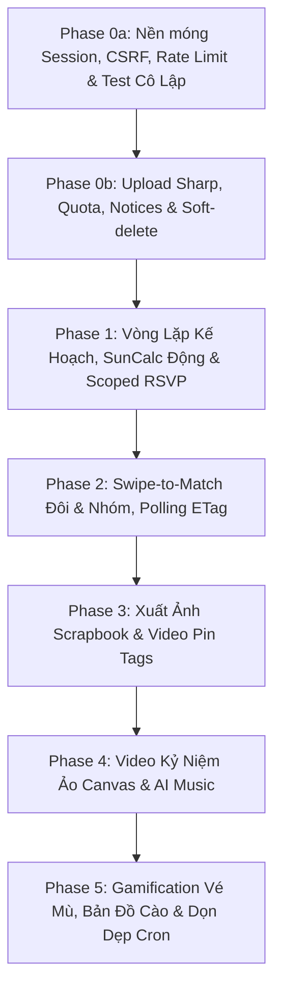

# DateMate - Kế hoạch Triển khai Toàn diện Độc lập (Master Implementation Specification)

> **Tài liệu bàn giao kỹ thuật độc lập (Standalone Engineering Specification)**  
> **Mục tiêu:** Xây dựng nền tảng hẹn hò DateMate bảo mật nhiều lớp, zero-friction (không cần mật khẩu), cách ly phòng đa khách thuê nghiêm ngặt (Zero Trust Room Isolation), trải nghiệm sổ tay dán ảnh cổ điển (Vintage Scrapbook) đầy cảm xúc và tối ưu chi phí hạ tầng máy chủ.  
> **Cam kết chất lượng:** Giữ vững 159 unit/integration tests hiện hữu, 0 lỗi TypeScript, 0 warning ESLint.

---

## 1. Hiện Trạng Hệ Thống & Bối Cảnh Mã Nguồn (System Baseline Context)

Trước khi bổ sung tính năng mới, hệ thống DateMate hiện tại đã có nền móng vững chắc:
- **Dữ liệu địa điểm:** 244 địa điểm published tại Hà Nội trên TiDB Cloud Serverless, đầy đủ ảnh HD Unsplash, cẩm nang hẹn hò (`opening_hours`, `price_level`, `moods`, `tags`, `cover_url`).
- **14 API Trang chủ & Khám phá:** Đã hoàn thiện 100%, kết nối mượt mà với UI.
- **Test suite:** 27 test files với **159 tests đang PASS 100%**.
- **Các bảng cơ sở dữ liệu đã tồn tại (Existing Schema):**
  - `rooms`: `id`, `name`, `member_count`, `invite_hash`, `invite_code_hash`, `invite_expires_at`, `anniversary_date`, `status` (`solo`, `paired`, `deleted`), `last_active_at`, `created_at`, `updated_at`.
  - `room_members`: `id`, `room_id`, `session_hash`, `recovery_hash`, `nickname`, `role` (`creator`, `partner`), `push_subscription`, `last_seen_at`, `revoked_at`, `created_at`.
  - `swipes`: `room_id`, `member_id`, `place_id`, `choice` (`like`, `nope`), `created_at`.
  - `matches`: `id`, `room_id`, `place_id`, `matched_at`, `status` (`open`, `planned`, `dismissed`).
  - `memories`: `id`, `plan_id`, `room_id`, `rating`, `journal`, `visited_at`, `createdAt`.
  - `memory_photos`: `id`, `memory_id`, `url`, `caption`, `sort_order`.
  - `memory_notes`: `id`, `room_id`, `member_id`, `content`, `color`, `created_at`.
  - `reminders`: `id`, `plan_id`, `member_id`, `remind_at`, `channel`, `sent_at`, `created_at`.
  - `date_plans`: `id`, `room_id`, `created_by`, `title`, `plan_date`, `start_time`, `status`, `budget`, `is_secret`, `reveal_at`, `note`, `created_at`, `updated_at`, `updated_by`.
  - `plan_stops`: `id`, `plan_id`, `place_id`, `custom_name`, `sort_order`, `planned_time`, `duration_min`, `note`.
  - `checklist_items`: `id`, `plan_id`, `content`, `is_done`, `assigned_to`, `sort_order`.
  - `places`, `place_blocklist`, `field_provenance`, `audit_logs`.

---

## 2. Kiến Trúc Bảo Mật, Hạ Tầng & Nguyên Tắc Vận Hành

### 2.1. Hạ Tầng Máy Chủ, Docker Volume & Sao Lưu Dự Phòng (VPS & Disaster Recovery)
- **Môi trường triển khai:** Chạy containerized trên VPS Coolify/Docker. Ứng dụng Next.js lắng nghe cổng nội bộ (chạy `3002` trong môi trường dev).
- **Lưu trữ tệp cục bộ (Local Persistent Storage):**
  - Toàn bộ ảnh kỷ niệm được lưu trữ vật lý tại `/data/datemate_storage/uploads/rooms/[roomId]/memories/[fileId].webp`.
  - Docker Container ánh xạ volume: `-v /var/lib/docker/volumes/datemate_storage/_data:/data/datemate_storage`.
  - Thư mục này nằm **hoàn toàn bên ngoài web root** (`public/`), cấm tuyệt đối truy cập trực tiếp qua static file server.
- **Chiến lược Sao lưu & Khôi phục (Disaster Recovery):**
  - **Database (TiDB Cloud):** Sao lưu tự động Point-in-time recovery (PITR) 7 ngày gần nhất.
  - **Storage tệp:** Script cron hàng đêm (03:00 AM) chạy lệnh `rclone` đồng bộ mã hóa thư mục `/data/datemate_storage` sang bucket S3/GCS dự phòng.
  - **Mục tiêu khôi phục:** RTO < 2 giờ (thời gian dựng lại service), RPO < 24 giờ (mất tối đa dữ liệu trong ngày). Có kịch bản kiểm thử phục hồi định kỳ.

### 2.2. Bảo Mật No-Auth Session & Quản Lý Khóa Khôi Phục (Recovery Key Rotation)
- **Phiên phòng Zero-Friction:** Không dùng username/password. Khi người dùng truy cập lần đầu:
  1. Server tự cấp một phòng solo mới và tạo bản ghi `room_members` với `session_hash = SHA256(cookieSecret)`.
  2. Gửi về client cookie `dm_s` (hoặc `__Host-dm_s`) với các cờ `HttpOnly; Secure; SameSite=Lax; Path=/; Max-Age=31536000`.
- **Định dạng & Băm Khóa Khôi Phục (Recovery Key):**
  - Khi tạo phòng hoặc vào cài đặt, server sinh khóa khôi phục Base62 ngẫu nhiên: `dm_rec_` + 32 ký tự alphanumeric (ví dụ `dm_rec_k9X2mQpL8vRt5wNz4yB1jFa3Sd6eHg0c`).
  - Chỉ hiển thị một lần duy nhất cho người dùng để lưu vào Notes/Ghi chú cá nhân, hoặc cung cấp dưới dạng link đồng bộ `https://datemate.app/r/sync?k=dm_rec_...`.
  - Server **chỉ lưu giá trị băm SHA-256** vào cột `room_members.recovery_hash`. Không bao giờ lưu bản rõ.
- **Cơ chế Xoay Key (Key Rotation) khi Phục Hồi:**
  - Khi thiết bị mới gọi `POST /api/v1/user/rooms/recovery-key/redeem` gửi `recoveryKey`:
    1. Server băm SHA-256 đối soát với `room_members.recovery_hash`.
    2. Nếu hợp lệ: Cấp session mới cho thiết bị này.
    3. **Bắt buộc Xoay Key (Rotate):** Thu hồi session cũ, sinh ngay một `newRecoveryKey` mới, cập nhật `recovery_hash = SHA256(newRecoveryKey)`, trả key mới về client để người dùng cập nhật lại ghi chú. Khóa cũ lập tức vô hiệu lực, ngăn chặn kẻ xấu nhặt được key cũ tiếp tục theo dõi phòng.

### 2.3. Checkbox Đồng Thuận Pháp Lý (Nghị Định 13/2023/NĐ-CP)
- Khi bắt đầu tạo phòng hoặc tải lên bức ảnh đầu tiên, giao diện hiển thị hộp thoại chấp thuận bảo vệ dữ liệu cá nhân:
  > ☑️ *"Tôi đồng ý để DateMate lưu trữ hình ảnh kỷ niệm trên máy chủ riêng của ứng dụng và áp dụng cơ chế xóa vĩnh viễn dữ liệu sau 14 ngày khi phòng bị giải tán (tuân thủ Nghị định 13/2023/NĐ-CP về Bảo vệ dữ liệu cá nhân)."*
- Ghi nhận `consent_version: "2026.1"` và thời điểm `consent_at` vào metadata của phòng. Không đồng ý thì không kích hoạt tính năng upload ảnh.

### 2.4. Phân Biệt Tuyệt Đối: Khách Xem Thiệp (RSVP) vs. Thành Viên Phòng (Room Member)
- **Khách xem thiệp:** Người nhận link thiệp mời lịch trình qua `POST /api/v1/user/plans/invite/[inviteToken]/rsvp`.
  - Chỉ được xem tóm tắt chặng, địa điểm công khai và xác nhận tham gia ("Chốt luôn! ❤️" / "Xin đổi giờ xíu ✍️").
  - **TUYỆT ĐỐI KHÔNG ĐƯỢC CẤP SESSION PHÒNG**, không được xem ảnh kỷ niệm, không có quyền can thiệp vào kho ký ức của cặp đôi.
  - Token mời kế hoạch `inviteToken` có thời hạn 72 giờ, lưu trong bảng `date_plans.share_token`.
- **Thành viên phòng:** Chỉ gia nhập thông qua `POST /api/v1/user/rooms/join` với mã mời hoặc token ghép đôi bí mật.

### 2.5. Luồng Xử Lý "Đã Có Phòng Solo Nhưng Click Link Mời Ghép Đôi"
Mọi người dùng khi mở web đều có một phòng solo mặc định. Khi click link mời:
- **Trường hợp A (Phòng solo trống):** Chưa có kế hoạch (`date_plans`), chưa có ảnh/ghi chú (`memories`, `memory_notes`):
  - Server tự động xóa phòng solo rỗng và gắn session người dùng vào phòng đôi mới.
- **Trường hợp B (Phòng solo đã có dữ liệu):** UI hiển thị modal cảnh báo rõ ràng:
  > *"Bạn đang có lịch trình tại phòng cá nhân hiện tại. Bạn muốn [Hợp nhất lịch trình vào phòng đôi mới] hay [Tải file sao lưu .zip trước khi đổi phòng]?"*
  Chỉ khi người dùng xác nhận trên UI mới thực hiện chuyển phiên, chống mất dữ liệu âm thầm.

### 2.6. Khắc Phục Triệt Để 4 Điểm Tranh Chấp Đồng Thời (Race Conditions)
1. **Join phòng đồng thời vượt `max_members`:**
   ```sql
   UPDATE rooms 
   SET member_count = member_count + 1 
   WHERE id = :roomId AND member_count < max_members;
   ```
   Nếu `affectedRows === 0`, server ném `400 ROOM_FULL`.
2. **Upload song song vượt Quota (Dung lượng 25MB & Số lượng 50 ảnh):**
   ```sql
   UPDATE rooms 
   SET storage_used_bytes = storage_used_bytes + :fileSizeBytes,
       photo_count = photo_count + 1 
   WHERE id = :roomId 
     AND storage_used_bytes + :fileSizeBytes <= storage_quota_bytes 
     AND photo_count < max_photos;
   ```
   Nếu ghi file vào ổ đĩa thất bại: Thực hiện câu lệnh trừ ngược lại để rollback quota.
3. **Like đồng thời & Snapshot Isolation:**
   - Dùng `INSERT INTO matches (id, room_id, place_id, matched_at, is_seen) VALUES (...) ON DUPLICATE KEY UPDATE id = id;`.
   - Logic kiểm tra match được thực hiện **ngay sau khi commit lượt quẹt** vào bảng `swipes`, đảm bảo nhìn thấy lượt like của đối phương vừa hoàn tất.
4. **Auto-Ripple Timeline & Cập nhật Kế hoạch:**
   - Mọi thao tác sửa lịch trình (`auto-schedule`, `ripple-shift`, `plan-b`, thêm trạm) sử dụng Optimistic Locking qua cột `version` của bảng `date_plans`.
   - Nếu `WHERE id = :id AND version = :clientVersion` không khớp, API trả về `409 CONFLICT` để UI thông báo: *"Đối phương vừa cập nhật lịch trình, vui lòng tải lại"*.

### 2.7. Bảo Mật Upload & Chống Decompression Bomb (Zero Client Trust)
- **Sharp Hardening:**
  - Ép cấu hình `sharp({ limitInputPixels: 16777216 })` (giới hạn 16 Megapixels, tương đương 4096x4096).
  - Chặn đứng tấn công Decompression Bomb: Các tệp nén vài chục KB nhưng giải nén thành 20.000x20.000 pixel sẽ bị `sharp` từ chối ngay lập tức ở tầng bộ đệm, ném `400 IMAGE_TOO_LARGE`.
  - Re-encode 100% sang định dạng `image/webp` chuẩn, loại bỏ toàn bộ EXIF, XMP, mã nhúng độc hại (Polyglot).
- **Phục vụ tệp bảo mật qua Streaming API:**
  - Endpoint `GET /api/v1/user/uploads/[fileId]` đọc tệp từ đĩa ngoài web root.
  - Bắt buộc kiểm tra quyền sở hữu: `WHERE room_id = session.roomId AND id = fileId`. Không khớp lập tức trả về `404 NOT_FOUND` (không tiết lộ sự tồn tại của tệp).
  - Response header bắt buộc có: `Content-Type: image/webp`, `X-Content-Type-Options: nosniff`, `Cache-Control: private, max-age=86400`.
  - Chống Directory Traversal: `fileId` bắt buộc validate bằng regex `^img_[a-zA-Z0-9_-]{16,24}$`.

### 2.8. Vòng Đời Phòng, Bảng Thông Báo Nội Bộ (`room_notices`) & Tải Kỷ Niệm
- **Bảng `room_notices`:** Quản lý thông báo trong app cho các sự kiện: Yêu cầu giải tán phòng, Match mới, RSVP phản hồi, Đổi giờ, Thư tình bí mật được mở.
- **Quy trình Soft-Delete 14 ngày có kiểm soát:**
  1. Khi một người bấm giải tán phòng: Phòng chuyển sang `pending_deleted_at = NOW()`.
  2. Tạo bản ghi thông báo trong `room_notices` gửi tới thành viên còn lại.
  3. **Đồng hồ 14 ngày CHỈ bắt đầu đếm khi thành viên kia đã xem thông báo (`seen_at`)**, hoặc cả 2 người cùng bấm đồng thuận giải tán phòng.
  4. Cung cấp nút `POST /api/v1/user/rooms/restore` cho phép hủy yêu cầu giải tán bất cứ lúc nào trong 14 ngày.
  5. Cung cấp endpoint `GET /api/v1/user/rooms/archive` đóng gói toàn bộ ảnh và nhật ký thành file `.zip` cho cặp đôi tải về máy làm kỷ niệm.
  6. Sau 14 ngày, cronjob đêm sẽ thực hiện Hard-Delete: Xóa vĩnh viễn các bản ghi DB và xóa toàn bộ tệp vật lý trong thư mục `/data/datemate_storage/uploads/rooms/[roomId]`.

### 2.9. Rate Limiting Chi Tiết Sau Reverse Proxy (Traefik / Coolify)
- **Lấy IP thực tế an toàn:**
  - Kiểm tra socket IP hoặc lấy IP đầu tiên từ `X-Forwarded-For` với reverse proxy đã whitelist.
- **Ngưỡng Rate Limit:**
  - **Tạo phòng mới:** Tối đa **5 phòng / IP / 24 giờ**.
  - **Đoán mã mời / Khôi phục key:** Tối đa **5 lần thử sai / 15 phút / IP**. Quá 5 lần, IP bị chặn thử trong 1 giờ.
  - **Global brute-force guard:** Tối đa 100 requests/phút trên toàn hệ thống cho endpoint `POST /rooms/join`.
- **Cơ chế lưu trữ:** Kết hợp In-memory LRU Cache (phản hồi siêu tốc < 1ms) và bảng `audit_rate_limits` trong DB (đồng bộ khi restart server).

### 2.10. Realtime Đồng Bộ Quẹt Thẻ Bằng Polling ETag & Trạng Thái Chưa Xem
- **Lựa chọn kiến trúc:** Sử dụng **Short Polling 3s có ETag** thay vì duy trì kết nối WebSocket/SSE phức tạp, tốn kém tài nguyên VPS.
  - Client gửi header `If-None-Match: [last_etag]`.
  - Nếu không có match mới: Server trả về `304 Not Modified` ngay lập tức (không payload, không tốn băng thông, tiêu thụ CPU cực thấp).
- **Xử lý bất đồng bộ (Asynchronous Swipes):**
  - Hai người thường không quẹt cùng một giây. Khi người B quẹt trùng điểm mà người A đã thích trước đó, bản ghi `matches` được tạo với cờ `is_seen = FALSE`.
  - Lần polling tiếp theo của người A phát hiện có match `is_seen = FALSE` -> Bắn pháo hoa Confetti chúc mừng trên UI -> Gửi request `POST /matches/[id]/seen` để chuyển sang `is_seen = TRUE`.

### 2.11. Thu Hồi Link Chia Sẻ & Quyền Riêng Tư Poster (Share Link Revocation)
- Poster Scrapbook xuất ra để chia sẻ lên Instagram/Facebook Story sử dụng link tĩnh độc lập: `GET /p/share/[shareToken]`.
- Tuyệt đối không nhúng `roomId` vào link poster.
- Header bắt buộc trên trang chia sẻ: `Referrer-Policy: no-referrer`, `X-Robots-Tag: noindex, nofollow`.
- Cung cấp nút trên UI phòng: *"Thu hồi link chia sẻ"* (`POST /api/v1/user/plans/[id]/share/revoke`) -> Lập tức xóa `share_token`.
- Trang hết hạn thân thiện: Khi truy cập link đã thu hồi hoặc hết hạn (sau 30 ngày), trang hiển thị thiệp phong bì cổ điển: *"Lịch trình này đã hết hạn hoặc được thu hồi bởi chủ nhân. Hãy tự lên kế hoạch hẹn hò của riêng bạn tại DateMate!"*

### 2.12. AI Tích Hợp (Gemini SDK) An Toàn & Kịch Bản Dự Phòng (Fallback Template)
- **Cấu hình Model:** Đọc từ biến môi trường `process.env.GEMINI_MODEL || "gemini-2.5-flash"`. Kiểm tra kết nối khi khởi động.
- **Quyền riêng tư 100%:** Tuyệt đối không gửi tên người dùng, địa chỉ nhà, ảnh thật hay nhật ký nhạy cảm lên AI. Chỉ gửi metadata trừu tượng: danh mục chặng (`cafe`, `food`), hashtags cảm xúc (`#langman`, `#sunset`), thông số thời tiết (`25°C`, `troi_trong`).
- **Cache & Fallback:** Kết quả sinh kịch bản video được lưu trong cột `memories.timeline_config`. Khi gặp lỗi Rate Limit (HTTP 429) hoặc mất mạng, server tự động fallback sang bộ mẫu kịch bản Heuristic Templates được biên soạn sẵn, đảm bảo người dùng không bao giờ gặp màn hình lỗi.

### 2.13. Dự Báo Thời Tiết (Open-Meteo) & Tốc Độ Di Chuyển Nội Đô Hà Nội
- **Ghi nhận bản quyền:** Hiển thị trên UI chân trang hoặc popup thời tiết: *"Dữ liệu thời tiết cung cấp bởi Open-Meteo (CC-BY 4.0)"*.
- **Cache tối ưu:** Cache dự báo thời tiết theo cặp `(district, date)` trong memory/DB với TTL 1 giờ. Tổng số request cả ngày < 24 calls cho toàn địa bàn Hà Nội.
- **Công thức tính thời gian di chuyển nội đô Hà Nội:**
  $$\text{Thời gian di chuyển (phút)} = \left(\frac{\text{Khoảng cách Haversine (km)} \times 1.35}{\text{Vận tốc (km/h)}} \times 60\right) + 10\text{ phút (Buffer tìm chỗ gửi xe)}$$
  - **Giờ cao điểm sáng (07:00 - 09:00):** Vận tốc trung bình = $15\text{ km/h}$.
  - **Giờ cao điểm chiều (17:00 - 19:00):** Vận tốc trung bình = $15\text{ km/h}$.
  - **Khung giờ bình thường:** Vận tốc trung bình = $25\text{ km/h}$.
- **Đối soát SunCalc:** Múi giờ chuẩn `Asia/Ho_Chi_Minh` (UTC+7). Bổ sung bộ unit test đối soát 12 ngày mẫu rải đều các tháng trong năm (15/1, 15/2, ..., 15/12), đảm bảo giờ hoàng hôn tính toán sai lệch không quá ±5 phút so với lịch thiên văn Hà Nội.

---

## 3. Mô Hình Dữ Liệu Toàn Diện (Database Schema & Migration Strategy)

### 3.1. Kế Hoạch Migration An Toàn Cho Các Bảng Sẵn Có
1. **Bảng `rooms` (Mở rộng):**
   ```sql
   ALTER TABLE rooms 
     ADD COLUMN room_type ENUM('couple', 'group') NOT NULL DEFAULT 'couple',
     ADD COLUMN max_members TINYINT NOT NULL DEFAULT 2,
     ADD COLUMN storage_quota_bytes INT NOT NULL DEFAULT 26214400, -- 25MB
     ADD COLUMN storage_used_bytes INT NOT NULL DEFAULT 0,
     ADD COLUMN photo_count INT NOT NULL DEFAULT 0,
     ADD COLUMN max_photos INT NOT NULL DEFAULT 50,
     ADD COLUMN version INT NOT NULL DEFAULT 1,
     ADD COLUMN consent_version VARCHAR(20) NULL,
     ADD COLUMN consent_at DATETIME NULL,
     ADD COLUMN pending_deleted_at DATETIME NULL;
   ```
2. **Bảng `date_plans` (Mở rộng):**
   ```sql
   ALTER TABLE date_plans 
     ADD COLUMN share_token VARCHAR(64) UNIQUE NULL,
     ADD COLUMN share_expires_at DATETIME NULL,
     ADD COLUMN version INT NOT NULL DEFAULT 1;
   ```
3. **Bảng `plan_stops` (Thêm cột an toàn & Backfill):**
   - Bước 1: Thêm cột `room_id` cho phép NULL:
     ```sql
     ALTER TABLE plan_stops ADD COLUMN room_id VARCHAR(21) NULL;
     ```
   - Bước 2: Backfill từ bảng cha `date_plans`:
     ```sql
     UPDATE plan_stops ps 
     JOIN date_plans dp ON ps.plan_id = dp.id 
     SET ps.room_id = dp.room_id;
     ```
   - Bước 3: Chuyển sang NOT NULL và tạo Index:
     ```sql
     ALTER TABLE plan_stops MODIFY COLUMN room_id VARCHAR(21) NOT NULL;
     CREATE INDEX idx_plan_stops_room_id ON plan_stops (room_id);
     ```
   - Bước 4: Thêm các cột tính toán thời gian:
     ```sql
     ALTER TABLE plan_stops 
       ADD COLUMN day_offset TINYINT NOT NULL DEFAULT 0,
       ADD COLUMN start_minute INT NOT NULL DEFAULT 0,
       ADD COLUMN travel_minutes INT NOT NULL DEFAULT 15,
       ADD COLUMN is_pinned_time BOOLEAN NOT NULL DEFAULT FALSE;
     ```
4. **Bảng `memory_photos` (Thêm cột an toàn & Backfill):**
   - Bước 1: Thêm cột `room_id` cho phép NULL:
     ```sql
     ALTER TABLE memory_photos ADD COLUMN room_id VARCHAR(21) NULL;
     ```
   - Bước 2: Backfill từ bảng cha `memories`:
     ```sql
     UPDATE memory_photos mp 
     JOIN memories m ON mp.memory_id = m.id 
     SET mp.room_id = m.room_id;
     ```
   - Bước 3: Chuyển sang NOT NULL và tạo Index:
     ```sql
     ALTER TABLE memory_photos MODIFY COLUMN room_id VARCHAR(21) NOT NULL;
     CREATE INDEX idx_memory_photos_room_id ON memory_photos (room_id);
     ```
   - Bước 4: Thêm liên kết upload:
     ```sql
     ALTER TABLE memory_photos ADD COLUMN upload_id VARCHAR(32) NULL;
     ```
5. **Bảng `matches` (Mở rộng cờ đã xem):**
   ```sql
   ALTER TABLE matches ADD COLUMN is_seen BOOLEAN NOT NULL DEFAULT FALSE;
   ```
6. **Bảng `memories` (Mở rộng cho Virtual Video Canvas):**
   ```sql
   ALTER TABLE memories 
     ADD COLUMN dominant_color VARCHAR(7) NULL,
     ADD COLUMN timeline_config JSON NULL,
     ADD COLUMN music_track_id VARCHAR(50) NULL;
   ```

### 3.2. Định Nghĩa DDL Cho Các Bảng Mới Hoàn Toàn

```sql
-- 1. BẢNG QUẢN LÝ TỆP TẢI LÊN BẢO MẬT (ROOM UPLOADS)
CREATE TABLE room_uploads (
  id VARCHAR(32) PRIMARY KEY, -- img_[nanoid]
  room_id VARCHAR(21) NOT NULL,
  member_id VARCHAR(21) NOT NULL,
  memory_id VARCHAR(21) NULL,
  file_name VARCHAR(255) NOT NULL,
  mime_type VARCHAR(50) NOT NULL,
  size_bytes INT NOT NULL,
  width INT NULL,
  height INT NULL,
  relative_path VARCHAR(255) NOT NULL, -- rooms/[roomId]/memories/[fileId].webp
  created_at DATETIME NOT NULL,
  deleted_at DATETIME NULL,
  INDEX idx_room_uploads_room (room_id, deleted_at)
);

-- 2. BẢNG THÔNG BÁO DÙNG CHUNG TRONG PHÒNG (ROOM NOTICES)
CREATE TABLE room_notices (
  id VARCHAR(21) PRIMARY KEY,
  room_id VARCHAR(21) NOT NULL,
  member_id VARCHAR(21) NULL, -- NULL nghĩa là gửi cho toàn bộ thành viên trong phòng
  notice_type ENUM(
    'room_delete_pending',
    'new_match',
    'plan_rsvp',
    'time_change_request',
    'secret_note_unlocked'
  ) NOT NULL,
  title VARCHAR(150) NOT NULL,
  content TEXT NOT NULL,
  metadata JSON NULL,
  read_at DATETIME NULL,
  created_at DATETIME NOT NULL,
  INDEX idx_room_notices_room_read (room_id, read_at)
);

-- 3. BẢNG PHẢN HỒI THIỆP MỜI LỊCH TRÌNH (PLAN RSVPS)
CREATE TABLE plan_rsvps (
  id VARCHAR(21) PRIMARY KEY,
  plan_id VARCHAR(21) NOT NULL,
  room_id VARCHAR(21) NOT NULL,
  responder_name VARCHAR(60) NOT NULL,
  status ENUM('confirmed', 'change_requested') NOT NULL,
  change_note TEXT NULL,
  created_at DATETIME NOT NULL,
  INDEX idx_plan_rsvps_plan (plan_id)
);

-- 4. BẢNG CHECK-IN ĐỊA ĐIỂM TỐI THIỂU HÓA DỮ LIỆU (PLACE CHECKINS)
CREATE TABLE place_checkins (
  id VARCHAR(21) PRIMARY KEY,
  room_id VARCHAR(21) NOT NULL,
  place_id VARCHAR(21) NOT NULL,
  member_id VARCHAR(21) NOT NULL,
  verified_method ENUM('gps_auto', 'manual_confirm') NOT NULL,
  checked_in_at DATETIME NOT NULL,
  UNIQUE KEY uniq_checkin_room_place (room_id, place_id),
  INDEX idx_checkins_room (room_id)
);

-- 5. BẢNG HỘP THƯ TÌNH BÍ MẬT TẠI QUÁN (SECRET NOTES)
CREATE TABLE secret_notes (
  id VARCHAR(21) PRIMARY KEY,
  room_id VARCHAR(21) NOT NULL,
  creator_id VARCHAR(21) NOT NULL,
  place_id VARCHAR(21) NOT NULL,
  content TEXT NOT NULL,
  hint VARCHAR(200) NULL,
  unlocked_at DATETIME NULL,
  created_at DATETIME NOT NULL,
  INDEX idx_secret_notes_room_place (room_id, place_id)
);

-- 6. BẢNG VÉ MÙ HẸN HÒ (BLIND DATE TICKETS)
CREATE TABLE blind_date_tickets (
  id VARCHAR(21) PRIMARY KEY,
  room_id VARCHAR(21) NOT NULL,
  plan_id VARCHAR(21) NOT NULL,
  budget_level ENUM('budget', 'medium', 'luxury') NOT NULL,
  current_step TINYINT NOT NULL DEFAULT 0,
  total_steps TINYINT NOT NULL DEFAULT 3,
  created_at DATETIME NOT NULL,
  INDEX idx_blind_tickets_room (room_id)
);

-- 7. BẢNG THEO DÕI RATE LIMIT BỀN VỮNG (AUDIT RATE LIMITS)
CREATE TABLE audit_rate_limits (
  id VARCHAR(64) PRIMARY KEY, -- [action]:[ip]
  attempt_count INT NOT NULL DEFAULT 1,
  first_attempt_at DATETIME NOT NULL,
  blocked_until DATETIME NULL,
  updated_at DATETIME NOT NULL
);
```

---

## 4. Đặc Tả Danh Mục API & Phân Loại Quyền Truy Cập

### 4.1. Danh Sách Endpoint Công Khai (Public Allowlist - Không Cần Session)
Các route này được miễn trừ khỏi kiểm tra `requireRoomSession()`:
1. `GET /api/v1/user/home/public` — Thông tin thời tiết, mặt trời và 3 địa điểm gợi ý công khai.
2. `GET /api/v1/user/places*` — Toàn bộ catalog địa điểm đã xuất bản.
3. `GET /api/v1/user/search/suggest` — Gợi ý tìm kiếm địa điểm.
4. `GET /api/v1/user/videos*` — Video review công khai.
5. `GET /api/v1/user/rooms/invite-preview?t=...` — Xem trước thiệp mời phòng (Read-only, chống bot pre-fetch).
6. `POST /api/v1/user/rooms/join` — Gia nhập phòng bằng token mời hoặc mã ngắn (Có rate limit).
7. `POST /api/v1/user/plans/invite/[inviteToken]/rsvp` — Khách phản hồi thiệp mời kế hoạch (Scoped Invite Token).
8. `GET /p/share/[shareToken]` — Trang xem ảnh poster lịch trình công khai tĩnh (Có header `noindex`, `no-referrer`).
9. `POST /api/v1/user/rooms/recovery-key/redeem` — Phục hồi phiên phòng bằng mã khôi phục bí mật (Có rate limit và tự động rotate key).

### 4.2. Danh Sách Endpoint Riêng Tư (Protected - Bắt Buộc `requireRoomSession()`)
Mọi truy cập không có cookie phiên hợp lệ hoặc truy cập tài nguyên của phòng khác **nhất quán trả về `404 NOT_FOUND`**:
- **Phiên Phòng & Quota:**
  - `GET /api/v1/user/rooms/me` — Thông tin phòng, thành viên, quota đã dùng/còn lại.
  - `POST /api/v1/user/rooms/consent` — Ghi nhận đồng thuận Nghị định 13/2023.
  - `POST /api/v1/user/rooms/invite` — Tạo token mời bí mật (`nanoid(32)`) và mã ngắn 8 ký tự `DM-X7K9-P2M4`.
  - `POST /api/v1/user/rooms/leave` — Rời phòng.
  - `DELETE /api/v1/user/rooms/me` — Yêu cầu Soft-delete phòng (14 ngày).
  - `POST /api/v1/user/rooms/restore` — Hủy yêu cầu xóa phòng trong 14 ngày.
  - `GET /api/v1/user/rooms/archive` — Xuất và tải file `.zip` toàn bộ kỷ niệm của phòng.
  - `GET /api/v1/user/rooms/notices` — Lấy danh sách thông báo nội bộ chưa đọc (`room_notices`).
  - `POST /api/v1/user/rooms/notices/[id]/read` — Đánh dấu đã đọc thông báo.
- **Lưu Trữ Ảnh Bảo Mật:**
  - `POST /api/v1/user/uploads` — Upload ảnh (re-encode sharp, atomic quota check 25MB).
  - `GET /api/v1/user/uploads/[fileId]` — Protected Media Streaming (kiểm tra quyền sở hữu phòng).
  - `DELETE /api/v1/user/uploads/[fileId]` — Xóa ảnh và hoàn trả quota dung lượng.
- **Lịch Trình & Auto-Ripple:**
  - `POST /api/v1/user/plans/[id]/auto-schedule` — Xếp lịch SunCalc theo giờ hoàng hôn Hà Nội & vận tốc xe máy.
  - `POST /api/v1/user/plans/[id]/ripple-shift` — Đẩy mốc thời gian dây chuyền (Optimistic Locking `version`).
  - `POST /api/v1/user/plans/[id]/plan-b` — Hoán đổi sang điểm `#indoor` khi Open-Meteo báo mưa.
  - `POST /api/v1/user/plans/[id]/stops` — Thêm trạm mới vào kế hoạch.
  - `POST /api/v1/user/plans/[id]/share` — Tạo `shareToken` độc lập để xuất poster Story.
  - `POST /api/v1/user/plans/[id]/share/revoke` — Thu hồi link chia sẻ poster.
  - `GET /api/v1/user/plans/[id]/poster-data` — Dữ liệu dàn trang Canvas Scrapbook.
  - `GET /api/v1/user/plans/[id]/export.ics` — Xuất file iCalendar đa chặng chuẩn RFC 5545.
- **Video Kỷ Niệm Ảo & Video Review:**
  - `POST /api/v1/user/memories/[id]/virtual-video` — Sinh kịch bản video từ ảnh THẬT của cặp đôi.
  - `GET /api/v1/user/memories/tracks` — Thư viện nhạc Royalty-Free nội bộ kèm `beatmap.json` offline.
  - `GET /api/v1/user/videos/[videoId]/hotspots` — Lấy Pin Tags ghim địa điểm trên video review.
- **Gamification & Quẹt Thẻ:**
  - `GET /api/v1/user/swipes/deck` — Bộ bài quẹt địa điểm cho phòng.
  - `POST /api/v1/user/swipes` — Gửi lượt quẹt (kiểm tra match sau khi commit).
  - `GET /api/v1/user/matches` — Danh sách điểm đã match (hỗ trợ Polling ETag).
  - `POST /api/v1/user/matches/[id]/seen` — Đánh dấu đã thấy match để tắt thông báo.
  - `POST /api/v1/user/gamification/blind-date` — Sinh vé mù (Server ẩn toàn bộ các trạm sau).
  - `POST /api/v1/user/gamification/check-in` — Check-in mở trạm vé mù, mở thư tình và cào bản đồ.
  - `POST /api/v1/user/gamification/secret-notes` — Viết thư tình ẩn tại quán.
  - `GET /api/v1/user/gamification/scratch-map` — Tính toán % khám phá 7 khu vực Hà Nội từ `place_checkins`.

---

## 5. Lộ Trình Triển Khai 6 Giai Đoạn (Chi Tiết & Thời Lượng Thực Tế)



### Phase 0a: Nền móng Phiên Phòng, Rate Limit & Test Cô Lập (3-4 ngày)
1. **Schema Migrations Đợt 1:**
   - Mở rộng bảng `rooms` (`room_type`, `max_members`, `storage_quota_bytes`, `storage_used_bytes`, `photo_count`, `max_photos`, `version`, `consent_version`, `consent_at`, `pending_deleted_at`).
   - Mở rộng bảng `date_plans` (`share_token`, `share_expires_at`, `version`).
   - Tạo bảng `audit_rate_limits`.
   - Chạy migration an toàn thêm `room_id` vào `plan_stops` và `memory_photos` (Nullable ➔ Backfill ➔ NOT NULL ➔ Index).
2. **Room Management & No-Auth Session:**
   - Hoàn thiện helper nhận diện IP thực sau reverse proxy Coolify/Traefik.
   - Module Rate Limit: Bộ đếm in-memory LRU + DB `audit_rate_limits`. Giới hạn 5 lần sai/15p cho mã mời, 5 phòng/ngày/IP.
   - Hoàn thiện sinh mã mời 8 ký tự `DM-X7K9-P2M4` (SHA-256 trong DB).
   - Hoàn thiện sinh Recovery Key `dm_rec_...` và luồng xoay key tại `POST /api/v1/user/rooms/recovery-key/redeem`.
   - Xử lý chuyển đổi: Phòng solo rỗng tự động xóa và chuyển; phòng solo có dữ liệu hiển thị modal xác nhận.
3. **CI Test Scanner & Test Helper Cô Lập Phòng:**
   - Xây dựng test helper `assertRoomIsolation(endpoint)`.
   - Viết **CI Route Scanner Script**: Quét 100% routes dưới `app/api/v1/user/` và fail CI ngay lập tức nếu route mới chưa được khai báo vào Allowlist hoặc Test cô lập phòng.

### Phase 0b: Upload Module Bảo Mật, Quota Guard & Vòng Đời Phòng (3-4 ngày)
1. **Schema Migrations Đợt 2:**
   - Tạo bảng `room_uploads` và `room_notices`.
2. **Upload Module với `sharp`:**
   - Cài đặt `sharp`. Xây dựng `POST /api/v1/user/uploads`: Validate magic bytes, cấu hình `limitInputPixels: 16777216`, re-encode WebP chuẩn max 2048x2048.
   - Atomic update kiểm tra đồng thời dung lượng `storage_used_bytes <= 25MB` và `photo_count < 50`.
   - Lưu trữ ngoài web root tại `/data/datemate_storage/uploads/rooms/[roomId]/memories/[fileId].webp`.
   - Xây dựng `GET /api/v1/user/uploads/[fileId]` stream binary có kiểm tra session và header `nosniff`.
   - Xây dựng `DELETE /api/v1/user/uploads/[fileId]` hoàn trả quota.
3. **Vòng Đời Phòng & Quản Lý Kỷ Niệm:**
   - Endpoint chấp thuận Nghị định 13/2023 `POST /rooms/consent`.
   - Soft-delete 14 ngày (`DELETE /rooms/me`), hủy xóa (`POST /rooms/restore`), gửi thông báo vào `room_notices`.
   - Xây dựng `GET /rooms/archive` đóng gói file `.zip` kỷ niệm cho người dùng tải về.

### Phase 1: Vòng Lặp Kế Hoạch, SunCalc Động & Scoped RSVP (3-4 ngày)
1. **Thuật Toán Xếp Lịch SunCalc & Vận Tốc Di Chuyển:**
   - Tính giờ hoàng hôn Hà Nội theo múi giờ `Asia/Ho_Chi_Minh` (UTC+7).
   - Tính thời gian di chuyển nội đô Hà Nội theo giờ cao điểm sáng (7-9h), chiều (17-19h) và buffer gửi xe 10 phút.
   - Lưu thời gian dạng `start_minute` và `day_offset` hỗ trợ lịch xuyên đêm.
2. **Timeline Dây Chuyền & Plan B:**
   - UI `InteractiveTimeline.tsx` hỗ trợ Auto-Ripple kéo giờ dây chuyền kèm Optimistic Locking `version` (xử lý lỗi `409 CONFLICT`).
   - Tự động hoán đổi trạm trong nhà Plan B khi Open-Meteo báo mưa (có cache quận/ngày và ghi nhận bản quyền CC-BY 4.0).
3. **Scoped RSVP & Thiệp Mời Phong Bì Sáp:**
   - Tạo bảng `plan_rsvps`. Endpoint `POST /plans/invite/[inviteToken]/rsvp` cho khách phản hồi mà không bị ép vào phòng.
   - Giao diện mở phong bì thư sáp niêm phong đỏ mận (`EnvelopeInviteModal.tsx`).
   - Xuất file `.ics` chuẩn RFC 5545 đa chặng (kiểm thử tương thích cả Apple Calendar và Google Calendar).

### Phase 2: Swipe-to-Match Đôi & Nhóm, Polling ETag (2-3 ngày)
1. **Bộ bài quẹt thẻ:** Giao diện thẻ bài Tinder-style trên nền bàn gỗ Scrapbook vintage.
2. **Post-Commit Match Engine:**
   - Ghi lượt quẹt vào `swipes`.
   - Kiểm tra match sau commit: Cặp đôi cần 2/2 lượt thích; Hội nhóm cấu hình đa số (`>= 50%`) hoặc 100%.
   - Cột `is_seen = FALSE` cho match mới.
3. **Realtime Polling ETag:** Polling nhẹ (3s) có ETag kiểm tra match mới, bắn pháo hoa Confetti và gửi thông báo vào `room_notices`.

### Phase 3: Xuất Ảnh Scrapbook & Video Pin Tags (2-3 ngày)
1. **Scrapbook Canvas Poster:**
   - Dàn trang template giấy craft, tem bưu chính, lộ trình nét đứt, QR code trỏ tới `/p/share/[shareToken]` công khai.
   - Nhúng font Base64 tường minh trong `html-to-image` chống lỗi glyph trên Safari iOS.
   - Nút thu hồi link chia sẻ `POST /plans/[id]/share/revoke` và trang hết hạn thân thiện.
   - Tùy chọn Privacy Toggle: "Ẩn mốc giờ và địa điểm chính xác trên ảnh".
2. **Video Pin Tags & Hotspots:**
   - Ghim vị trí lơ lửng trên video player (`VideoPlayerModal.tsx`) kèm nút `+ Vào lịch` (`POST /plans/[id]/stops`).
   - Carousel gợi ý 2-3 điểm tương tự cùng quận.

### Phase 4: Video Kỷ Niệm Ảo (Virtual Video Canvas) & Nhạc Nền AI (3-4 ngày)
1. **Canvas Ken Burns 60fps:**
   - Render ảnh THẬT của cặp đôi trong phòng lướt chậm trên Canvas (hỗ trợ `prefers-reduced-motion` chuyển sang Crossfade tĩnh).
   - Âm thanh và đĩa than xoay tròn **chỉ phát sau cử chỉ click của người dùng**.
2. **Offline Beat-Sync:**
   - Đọc nhịp chuyển cảnh từ file `beatmap.json` đo sẵn của từng bài trong thư viện Royalty-Free nội bộ.
3. **Gemini SDK Anonymized Integration:**
   - Model cấu hình qua `process.env.GEMINI_MODEL`, chỉ gửi hashtag cảm xúc và thời tiết ẩn danh, cache theo `memoryId`, có fallback template Heuristic khi lỗi 429.

### Phase 5: Gamification Vé Mù, Bản Đồ Cào & Dọn Dẹp Cron (3 ngày)
1. **Tạo bảng `place_checkins`, `secret_notes`, `blind_date_tickets`.**
2. **Vé Mù Hẹn Hò:** Server ẩn hoàn toàn các trạm sau, chỉ trả về trạm tiếp theo khi đã check-in trạm trước.
3. **Bản đồ cào 7 khu vực Hà Nội:** Tính toán `% = (Số quán đã check-in / Tổng quán) * 100` trực tiếp từ `place_checkins` (chống race condition).
4. **Hộp thư bí mật:** Check-in tối thiểu hóa dữ liệu (bán kính 300m hoặc nút xác nhận thủ công) để mở thư tình.
5. **Dọn dẹp tự động:** Cronjob hard-delete phòng quá hạn 14 ngày soft-delete, xóa sạch tệp trên đĩa và cập nhật chính sách bảo mật Nghị định 13/2023.

---

## 6. Tiêu Chuẩn Nghiệm Thu Đo Lường Được (Measurable QA Acceptance Criteria)

| Hạng mục kiểm thử | Môi trường / Thiết bị Mục tiêu | Tiêu chí Nghiệm thu Đo lường Được |
| :--- | :--- | :--- |
| **CI Route Scanner** | Toàn bộ cây thư mục `app/api/v1/user/` | 100% route được phân loại vào Allowlist hoặc Test cô lập phòng. CI fail ngay nếu phát hiện route mới chưa đăng ký! |
| **Bảo Mật Cô Lập Phòng** | Toàn bộ API riêng tư | 100% test case User phòng A truy cập tài nguyên phòng B trả về mã `404 NOT_FOUND`. |
| **Upload Bảo Mật & DoS** | Test ảnh Decompression Bomb (16MP), SVG XSS, Polyglot | Sharp chặn đứng ảnh vượt 16MP, re-encode WebP thành công, header luôn có `X-Content-Type-Options: nosniff`. |
| **Race Conditions** | Chạy kiểm thử song song (20 luồng đồng thời) | `member_count` không bao giờ vượt 2, dung lượng không vượt 25MB, không tạo match trùng. |
| **Độ Chính Xác SunCalc** | Đối soát 12 ngày mẫu rải đều các tháng trong năm | Giờ hoàng hôn tính toán trùng khớp bảng thiên văn chuẩn Hà Nội trong khoảng ±5 phút. |
| **Virtual Video Canvas** | Android tầm trung (Snapdragon 680) & iPhone SE | Canvas render ổn định ~55-60fps; bật reduced-motion chuyển mượt sang crossfade tĩnh; âm thanh chỉ phát sau click. |
| **Xuất Ảnh Scrapbook** | Safari iOS & Chrome Desktop | Xuất ảnh .png dưới 1.2s, font tiếng Việt hiển thị sắc nét không lỗi ô vuông/glyph. |
| **Đồng Bộ iCalendar** | Apple Calendar & Google Calendar | File `.ics` import thành công hiển thị đủ các chặng, thời gian và địa điểm. |
| **Type-check & Lint** | Toàn bộ repository | 0 lỗi TypeScript (`tsc --noEmit`), 0 warning ESLint (`next lint`). Toàn bộ 159 tests cũ tiếp tục PASS 100%. |

---

## 7. Kế Hoạch Bắt Đầu Thực Thi Ngay (Immediate Execution Next Steps)

Sau khi được phê duyệt kế hoạch, nhóm kỹ thuật sẽ kích hoạt ngay **Phase 0a: Nền móng Phiên Phòng, Rate Limit & Test Cô Lập**:
1. Tạo migration SQL Đợt 1 và cập nhật Drizzle Schema files (`server/db/schema/rooms.ts`, `server/db/schema/plans.ts`, `server/db/schema/interactions.ts`).
2. Viết helper lấy IP chuẩn, module Rate Limit in-memory + DB và logic băm SHA-256 mã mời / recovery key rotation.
3. Viết test helper `assertRoomIsolation(endpoint)` và CI Route Scanner script.
4. Chạy kiểm thử hồi quy bảo đảm 159 tests tiếp tục PASS 100%.
